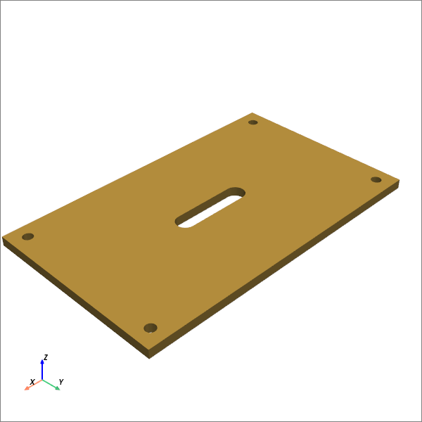
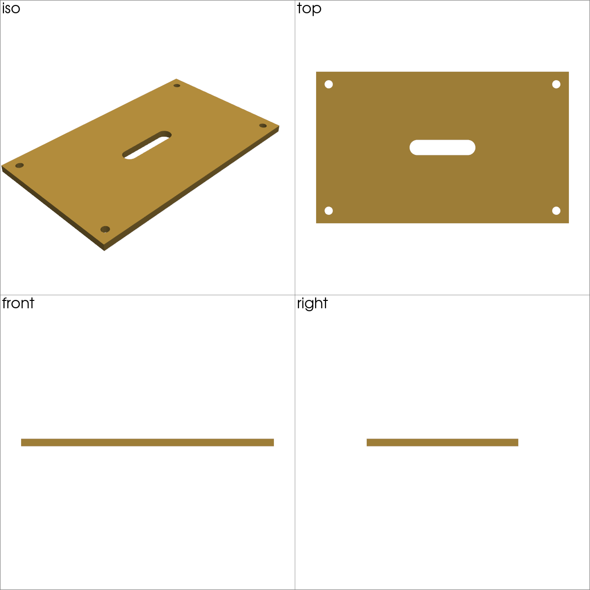

# workshop
My home workshop stuff.

Rules for the agent are in `AGENTS.md` (not here!)

Machines are in `equipment.md`

## Layout

| Path | What |
|---|---|
| `src/shop/` | Helpers: export every format at once, headless PNG render, test loader |
| `projects/<slug>/` | One part each: `README.md`, `model.py` or `model.scad`, `test_model.py`, `out/` |
| `projects/calibration/` | First real project: fit numbers for the printer and laser |
| `.github/workflows/build.yml` | Tests and builds every Python model on push |

## Commands

    uv sync
    uv run python projects/demo-bracket/model.py
    uv run pytest -q

## Gallery

| demo-bracket | demo-plate |
|---|---|
|  |  |
|  |  |
