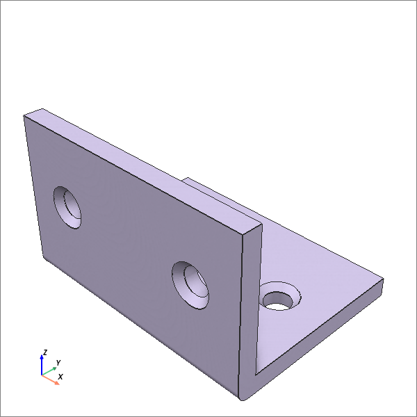
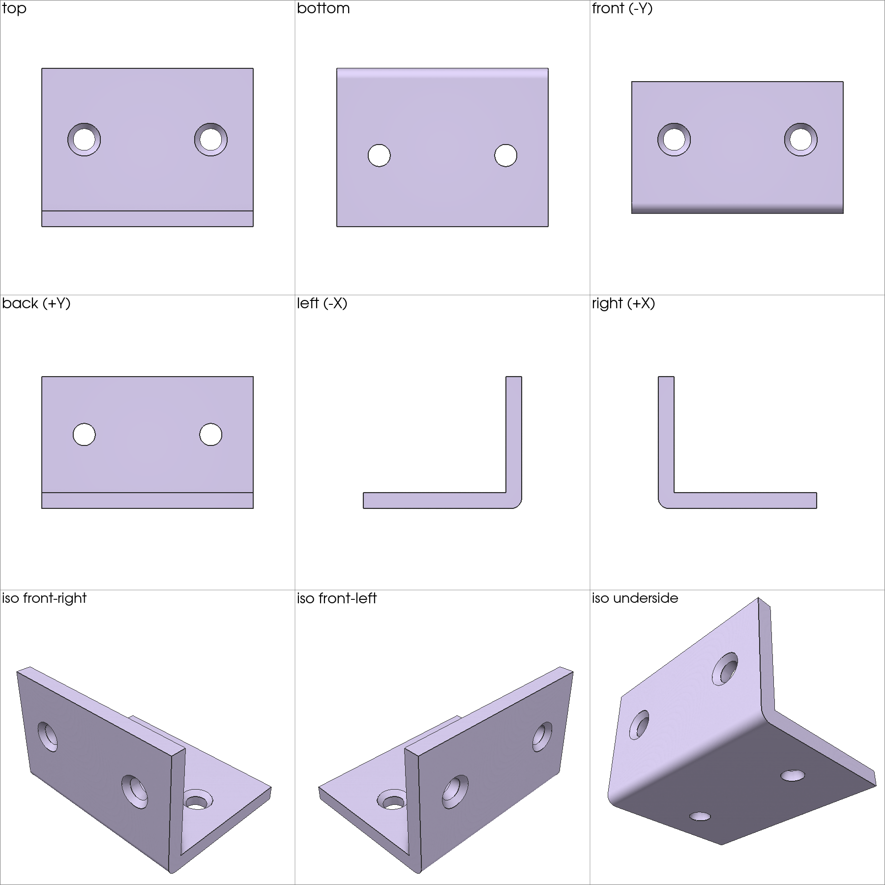
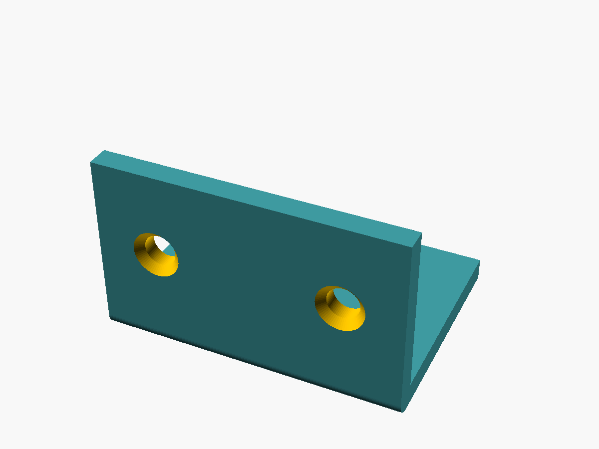

# workshop
My home workshop stuff.

Rules for the agent are in `AGENTS.md` (not here!)

Machines are in `equipment.md`

## Layout

| Path | What |
|---|---|
| `src/shop/` | Helpers: export every format at once, headless PNG render, test loader |
| `projects/<slug>/` | One part each: `README.md`, `model.py` or `model.scad`, `test_model.py`, `out/` |
| `fusion/` | Fusion 360 scripts, run inside Fusion |
| `projects/calibration/` | First real project: fit numbers for the printer and laser |
| `.github/workflows/build.yml` | Tests and builds every Python model on push |

## Setup

    ~/workshop/setup.sh     # puts `shop` on PATH; yadm bootstrap runs it

Then `shop build`, `shop doctor` (which tools this box has), `shop fusion`
(the folder to add in Fusion's Scripts panel) from any directory.

## Commands

    uv sync
    uv run python -m shop.build                      # every project, .py and .scad alike
    uv run python -m shop.build projects/demo-bracket  # one project
    uv run pytest -q

`.scad` models build through whatever OpenSCAD the box has (`src/shop/scad.py`);
on WSL the Windows Nightly is preferred when installed. `projects/README-ab.md` is the measured
OpenSCAD vs build123d comparison on the two demos.

## Gallery

| demo-bracket |
|---|
|  |
|  |
|  |

Third row: the same parts from `model.scad`, rendered by OpenSCAD.
