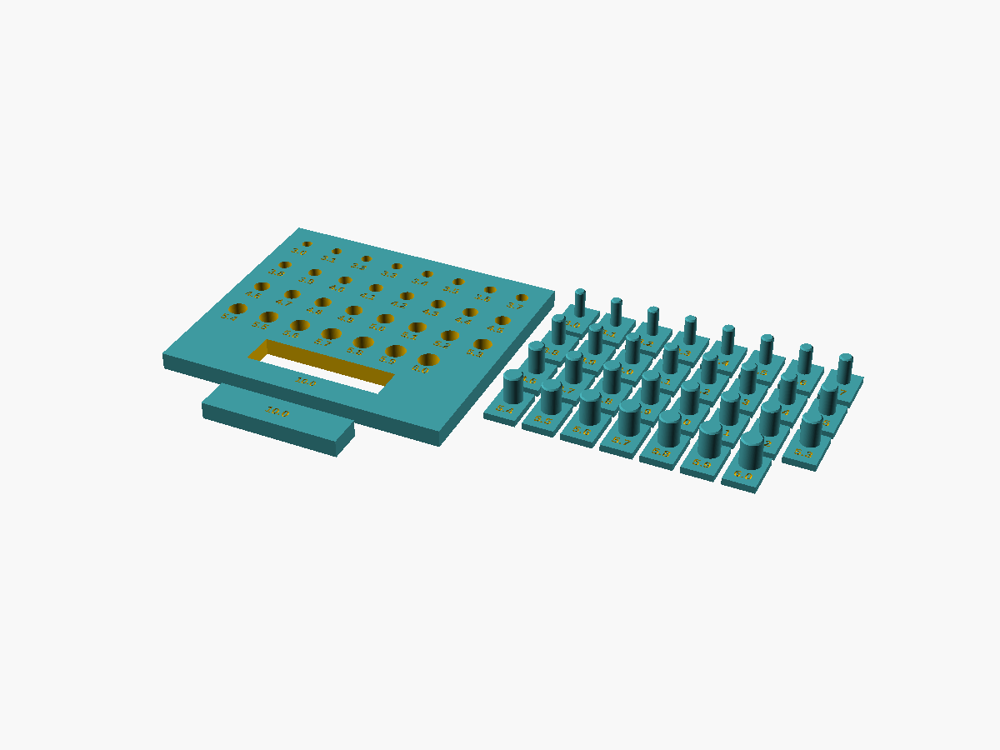
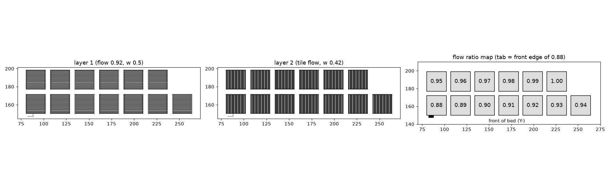

# calibration

First real project. Measures the fit numbers in `AGENTS.md` so nothing ships on
a guess. Two halves: a printer tolerance test and a laser kerf test.

## Part 1: K2 Plus tolerance print (ASA)

One build plate, printed in ASA in the model orientation:
`out/calibration_scad.3mf` from `model.scad`. Every hole and peg is debossed
with its modelled diameter.

| Body | Feature | Range | Purpose |
|---|---|---|---|
| Hole plate, 84 x 74 x 5 mm | 31 through holes | 3.0 to 6.0 mm in 0.1 steps | Which modelled diameter yields which real bore |
| Hole plate | Slot | 10.0 x 40 mm | Horizontal expansion on an inside edge |
| Gauge bar | Outer width | 10.0 x 40 x 5 mm | Horizontal expansion on an outside edge; also tries the slot |
| 31 peg tabs, 9 x 13 x 2 mm | Peg standing 8 mm, 0.4 mm lead-in | Same as the holes | Press fit against the holes |

Slicer: X-Y hole and contour compensation and elephant-foot compensation at
0 for this print, or the numbers measure the slicer, not the printer. Note
the nozzle fitted (equipment.md: it changes). Measure bores mid-depth, away
from the first layer.

| Measured | How | Fills AGENTS.md row |
|---|---|---|
| Real bore of every hole | Caliper or pin gauge; smallest hole a nominal M3/M4/M5 shank passes freely | K2 Plus hole clearance (ASA) |
| Which peg holds in which hole by hand pressure | Trial | K2 Plus press fit |
| Slot width and plate outer dimensions against model | Caliper | K2 Plus horizontal expansion |

## Part 2: K40 kerf cut, per material

A comb of slots and a measured square per material.

| Material | Measured | Fills AGENTS.md row |
|---|---|---|
| 3 mm ply | Square outer size minus model, and slot width minus model, both halved | K40 kerf, 3 mm ply |
| 3 mm acrylic | Same | K40 kerf, 3 mm acrylic |

The K40 half is a live session: the user runs it from the workshop Mac in
LightBurn, reads back caliper numbers, and the agent fills the table.
Card 1793768721f8cb0073.

## Not in this project

Router end-mill runout waits for a dial indicator and a known-good collet.

## Part 3: flow ratio, per filament

`flow_ratio.py` writes `out/flow_ratio_<material>.gcode`: 13 solid tiles, flow 0.88 to 1.00, started over
Moonraker without the slicer. The tab marks the front edge of 0.88; the map is `out/flow_ratio_<material>.png`.
The smoothest top with no gaps between lines is the filament profile's flow ratio.

