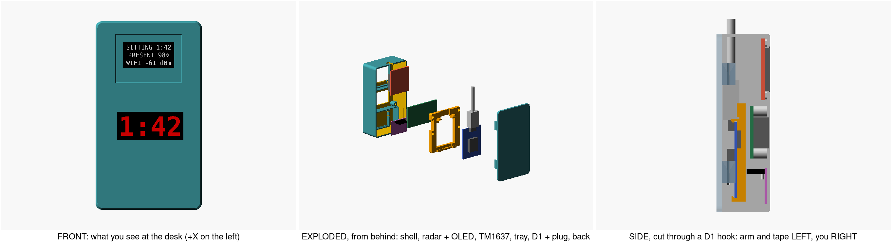

# Desk presence sensor

Symphony: none yet

Purpose: a sitting timer for the desk. An LD2410C radar senses you in the chair, a D1 mini
(ESP8266) counts, the TM1637 shows the timer and the OLED shows troubleshooting and other stats.
The box is 45 wide to match the monitor arm stem. Its flat back tapes to the arm with double-sided
tape, facing the chair, so nothing goes through the back: the **shell** (face and walls in one print)
carries the face boards and the shallow **back plate** snaps gently into it. A printed **tray** screws
onto the TM1637's back with the TM1637's own screws and holds the D1 mini flat behind the radar and
TM1637, USB up. The only openings are the two display windows and the cable slot in the top. Not sealed.

Outside: 45 x 80.2 x 22.2 mm (was 45 x 81 x 52 with the D1 mini on edge).

## Requirements

Owner's, 2026-11-20. Numbered so a change can cite one.

| # | Requirement | Why |
|---|---|---|
| R1 | The segmented display (TM1637) is the lowest of the displays | easiest to see at the desk |
| R2 | The OLED sits just above the segmented display | next easiest to see |
| R3 | The radar sensor sits low, clear of the monitor | the monitor bezel blocks its view |
| R4 | The bottom-most position is the segmented display or the radar (R1 and R3 compete for it) | |
| R5 | The USB cable exits up and back through the top wall, never through the back | the back is taped flat |
| R6 | The back is flat and taped to the monitor with double-sided tape: no screws or openings that the tape must cover | |
| R7 | 45 mm wide, to match the monitor arm stem | |
| R8 | PETG, no supports | print economy |
| R9 | Stacking order, bottom to top: radar, TM1637, OLED. Held, 2026-11-21 | settles R4 |
| R10 | Back flat and shallow; it closes with a gentle snap. Held, 2026-11-21 | |
| R11 | The D1 mini may be bare: no male header pins assumed | one on hand is bare |

Status: the order is radar (bottom), TM1637, OLED; the D1 mini lies flat on a tray behind the radar
and TM1637, USB up, and the cable leaves through the top wall near the back (R1 to R11 met). Not yet
printed or checked against the real monitor.

## Prints, PETG, no supports

| Part | File | Orientation | Overhangs |
|---|---|---|---|
| Fit gauge, **print first** | `part-gauge.scad` | flat, face down | none: the face with the radar's slot, lips and ribs, the TM1637 and OLED posts and seat ribs at full depth; no walls, no tray seats |
| Shell | `model.scad` | front face down | none: posts and ribs rise from the face; windows and pilots run straight through; cable slot open to the rim |
| Back plate | `part-back.scad` | tape face down | tab bumps are 45° both faces |
| D1 tray | `part-tray.scad` | on its front (the face on the TM1637), D1 side up | corner-hook and top-hook catches have 45° undersides; the stop block has no overhang; windows run straight through; hook posts stand free over a 0.6 root layer |

## How it goes together

```
 depth stack, z from the outer face (mm)
 face 0-1.5 | TM1637 display 0.5-7.5 | board 7.5-9.1 | tray 9.1-13.1 | D1 13.1-14.1, can to 17.3
            | USB plug 11.9-19.4 (sets the depth) | rim 19.7 | back plate 19.7-22.2 (taped)
```



The tray is a frame. Its front bears on the TM1637's back along two side rails and a band above the
display pins, with the four screw pads in them; windows clear the display pins, the header joints
at the -X end and the D1's underside parts, and the plug passes over a 1.6 mm strap on the front
face that closes the frame. The TM1637's four screws go tray -> board ->
post, so the tray needs no fixings of its own. The D1 mini lies on the tray's back, underside to
the tray, can toward the arm: its lower short edge bears on a centre stop block (flush with the board's face, so the wifi module's can clears it) and tucks under two corner hooks either side of it, with a 1 mm pocket in the seat beside the block for whatever sticks out under the module, and two hooks at the top
corners, beside the USB socket, snap over its upper short edge. The long edges, with the pad rows,
touch nothing. The USB plug points straight up behind the OLED; the cable lies in the top-wall slot.
The back plate's four tabs click 0.5 mm bumps into V grooves in the side walls; pry at a corner to open.

## Layout (front view, top to bottom)

```
 +------[cable]+   cable slot in the top wall, open to the back rim
 | +---------+ |
 | |  OLED   | |   window 24 x 13; four M2 x 4-5 self-tappers into posts
 | +---------+ |
 |[ 88:88 ]  :|   TM1637 window; four M2.5 x 10 self-tappers through the tray and board into posts
 | (radar)   : |   no hole, looks through the 1.5 mm face; rib pocket, dab of hot glue
 +-------------+   ':' = D1 mini flat on the tray behind, centred, USB end up
```

## Assembly

1. Solder short wires to every board first: no Dupont housings anywhere. Clip the radar and OLED
   header pins short. TM1637: clip the bent header pins off flush with the black plastic and solder
   four wires to the joints on the board's back. D1 mini (bare is fine): wires in from the underside,
   soldered on the can side.
2. OLED: glass flush in its pocket, the board between the frame ribs, four M2 self-tappers from behind.
3. Radar: antenna side to the face. Tilt the board and tuck its whole lower edge into the slot under the bottom lip, then press the upper end flat until the two upper lips click over it. To remove, lift the upper end past the lips (press them apart) and tilt out. No glue.
4. TM1637 and tray: display into its window, the tray's front on the board's back (header window at
   the -X end), four M2.5 x 10 self-tappers through tray and board into the posts.
5. D1 mini: underside to the tray, USB end up. Tuck the lower edge under the lip, press the top end
   down until both hooks click. Plug in the USB cable; lay the cable in the top slot.
6. Wires per the table, then press the back plate in until the tabs click. Tape the back to the arm.

## Wiring (soldered, D1 mini side)

| From | D1 mini |
|---|---|
| Radar 5V, GND | 5V, G |
| Radar TX | D7 (GPIO13), UART0 swapped |
| Radar RX | D8 (GPIO15) |
| OLED VCC, GND, SCL, SDA | 3V3, G, D1 (GPIO5), D2 (GPIO4) |
| TM1637 VCC, GND, CLK, DIO | 3V3, G, D5 (GPIO14), D6 (GPIO12) |

The radar takes the hardware UART at 256000 baud, so the logger moves to D4 (GPIO2), as in
[d1-mini-sensor-node](../d1-mini-sensor-node/esphome/node.yaml). Radar OUT is not wired; D5 now
drives the TM1637. Firmware: [`esphome/desk.yaml`](esphome/desk.yaml).

## Measured, and from what

| Value | mm | Source |
|---|---|---|
| TM1637 board, holes, display | see [`parts.md`](../../parts.md) | owner, caliper |
| Pin directions: D1 mini male out the back, OLED out the back, radar out the back | | owner, by eye |

## Guessed (the gauge checks the face ones)

| Value | Now | Why |
|---|---|---|
| D1 mini, LD2410C outlines | 34.2 x 25.6, 22 x 16 | vendor drawings, not calipered |
| D1 stack: board, can, underside parts | 1.0, 3.2, 2 | vendor numbers |
| USB plug overmold `plug_w` x `plug_t` x `plug_l`; socket axis `usb_h` | 11 x 7.5 x 18; 1.5 above the board | overmolds vary; **the plug sets the depth** |
| TM1637 back: joints `tm_joint_h`, display pin rows `tm_pin_row` | 1.5; two rows 10.16 apart, within x -7.1 to 5.6 | typical 0.36" display; the tray's windows assume the rest of the back is bare |
| Radar hooks `rd_hook`, snap lips `rd_lip`, `rd_beam_t`, `rd_slot`, `rd_lip_gap` | one lip 0.9 over the whole lower edge; two upper lips 0.7 over the side edges on 0.8 thick beams between 1 mm slots; 0.1 above the board; 45° slopes | guessed; 0.2 per side interference, flex by estimate about 10-30 N |
| OLED reverse chamfer `ol_rev`, `ol_rev_w` | 0.8 deep at 45° below the glass's lower end, 14 wide | clears the ribbon end, whose height is not measured |
| OLED header relief `ol_pin_rec`, `ol_pin_w` | 1.0 deep into the 1.5 face (0.5 skin left), 14 wide, from the glass's upper edge to the wall | for the solder nubs on the board front; trim them to under 1.9 above the board |
| TM1637 seat `tm_rib_t`; tray seats `tray_seat_w` | 0.8 ribs along the board's top and bottom edges, stopping 0.2 under the board's back; 1.2 wide blocks along each wall, tops 0.05 under the tray's front plane | the tray rests on the TM1637's back and on these blocks where it overhangs the radar zone |
| Tray front plane `tray_z0`, `screw_head`, `rd_pin_clr` | the larger of TM1637 back + 1.5 (screw heads) and radar pins + 0.5: 11.0 | the tray no longer rests on the TM1637; it rests on the wall seat blocks, box 1.9 deeper (owner, 2026-11-22) |
| OLED frame `ol_slack`, `ol_rib_t` | 0.3 per side, 1.2 thick; sides and bottom only | the top edge meets the wall |
| Radar back `rd_back` | 8 behind its board | normal male pin headers, owner 2026-11-22; they end 1.4 mm into the tray's window, 2.6 short of the D1 |
| Hook catch `catch`, lower corner hooks `lip_catch`, pocket `stop_rec`, post `hook_t`, clearance `d1_clr` | 0.6 over the board, 0.8, 1.0 (guessed from "under 1 mm", not calipered), 1.0 thick, 0.2 | about 3 % strain at the catch, gentle for PETG by estimate |
| Snap `bump` | 0.5 | calibration pending |
| OLED holes, glass | 23.3 x 23.6; glass 26.7 x 19.3, 2.4 thick, centred | generic drawing |
| OLED active-area offset `ol_win_dy` | 1.5 toward the header | typical module; the gauge shows it |
| ESP can height | 3.2 | typical D1 mini |
| Pilots `tm_pilot_d`, `ol_pilot_d`; tray clearance `tray_hole_d` | 2.2, 1.6; 3.0 | calibration pending |

## Open

- The USB plug sets the depth: its back sits 2 mm behind the ESP can.
- Firmware: sitting timer on the TM1637, stats on the OLED.
- Other D1 placements weighed 2026-11-21: flat on the floor (USB out a side wall), upright parallel
  to the face (its Dupont stack adds to the displays' depth, and it covers screws).
