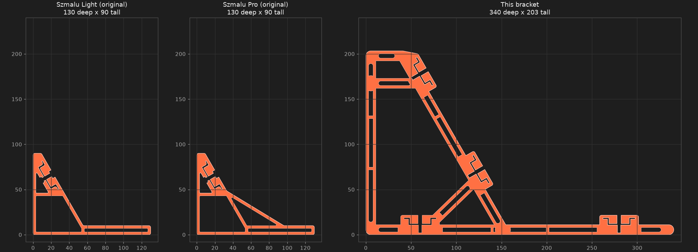
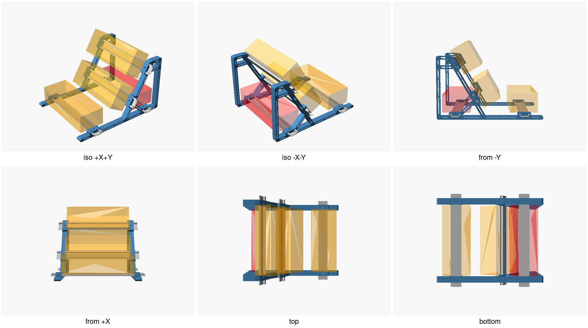

# DIN-rail bench stand

Symphony: none yet

Purpose: a desk "mini rack" for the bench: PSUs, buck/boost, a Pi or ESP32 on breakouts, a V/A meter, within reach.
Several stands sit side by side. Each stand is two of these end brackets and four TS35 rails cut to length:
two across the sloped face, one flat on the foot in front, and one flat at the back under the face for AC gear
(a small PSU, mains terminals, relays), out of reach from the front.

The construction is Szmalu's [DIN Rail Stand KIT](https://www.thingiverse.com/thing:3609072) (CC BY-NC), which holds one rail:
an A-frame end bracket, a thick plate of thin ladder bars, the rail passing through a slot of its own section.
Nothing of its mesh is used; this one is scaled up to hold four rails.

Prototype, not printed. Nothing here is measured.

`view="assembly"` stands two brackets up with 300 mm rails and orange module envelopes (90 tall, 70 deep); the back rail's are red (65 deep).
Front of the desk is +X (right in the side view).

## Sizes

| Size | Value | Source |
|---|---|---|
| Rail | TS35, 35 × 7.5 | standard |
| Face slope | 60° above the desk | guess |
| Tier pitch, along the face | 125 | 90 module + wiring room; guess |
| Module envelope | 90 tall, 70 deep from the rail face; 65 on the back rail | 90 is standard; the depths are guesses |
| Face set forward of the back post | 35, to fit the back rail's modules | the model; the test holds 5 mm to the frame |
| Gap, tier 1 envelope to flat-rail envelope | ≥ 10 (test) | guess |
| Plate, across the rail | 20 | the original's, unscaled |
| Bars | ladders 11 wide: two 3 mm strips, a 5 mm slot, a rung at least every 70 | the original's foot |
| Rail slot | the TS35 section, 0.3 clearance each side of the sheet | guess; gauge it |
| Bracing | the face ends in the top rail block; a crossbar from the back post meets that block 8 below the rail centre; a diagonal from 8 below the lower rail centre runs to the back rail block, a triangle with face and foot | the original's top corner and crossbar; the triangle is ours |
| Footprint, side | 340 deep × 203 tall | the model |
| Bracket volume | 166 cm³ each (was 102.5 with screw-on pads, 10 thick); the four rail blocks, 43 × 21.5 × 20 each, are most of the rise | the model |
| Screw | M4 × 16 self-tapping: 4.6 clear through the cover and channel, 3.7 pilot 9 deep below the rail base | guess; printed holes run small, gauge it |

## How a rail is held

The rail passes through the bracket in a slot of its own cross-section, cut through a solid block on the bar.
The slot's flat faces hold the rail's base and lips from both sides, so it cannot move except along its length.
One M4 screw per rail end, from the block's outer face, runs through the plastic in the rail's channel and a slot
in its base into a pilot below, and pins it lengthwise. Slide the rail through both brackets;
cut it so a base slot sits mid-plate (10 in from either face) at each bracket.

Modules clip onto the rail between the brackets, so they only need room from each other, not from the frame.

## How it prints

Flat, as modelled, 20 mm tall; every wall is vertical, so no overhangs. The rail slots and ladder slots run straight
through. The four screw holes run sideways at mid-height with a point-up (teardrop) top.

Print the gauge first (`out/din-rail-bench-stand_gauge.3mf`, 8 cm³): one rail block, 10 tall.
Slide a rail offcut through and drive the screw; adjust `rail_clr`, `clear_d`, `pilot_d` before the brackets.

## Open

- Rail slot clearance and M4 hole fit in PETG: unmeasured; the gauge settles both.
