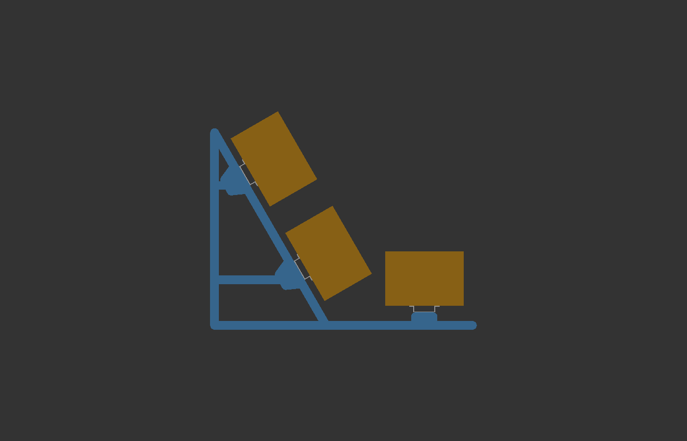

# DIN-rail bench stand

Symphony: none yet

Purpose: a desk "mini rack" for the bench: PSUs, buck/boost, a Pi or ESP32 on breakouts, a V/A meter, within reach.
Several stands sit side by side. Each stand is two of these end brackets and three TS35 rails cut to length:
two rails across the sloped face, one above the other, and one lying flat on the foot in front of them.

The idea, a pair of A-frame end brackets with the rail screwed to the sloped edge, is Szmalu's
[DIN Rail Stand KIT](https://www.thingiverse.com/thing:3609072) (CC BY-NC), which holds one rail. Nothing of its mesh is used.

Prototype, not printed. Nothing here is measured.

`view="assembly"` stands two brackets up with 300 mm rails and orange module envelopes (90 tall, 70 deep).
Front of the desk is +X (right in the side view).

## Sizes

| Size | Value | Source |
|---|---|---|
| Rail | TS35, 35 × 7.5 | standard |
| Face slope | 60° above the desk | guess |
| Tier pitch, along the face | 125 | 90 module + wiring room; guess |
| Module envelope | 90 tall, 70 deep from the rail face | 90 is standard; 70 is a guess |
| Gap, tier 1 envelope to flat-rail envelope | ≥ 10 (test) | guess |
| Footprint, side | 305 deep × 231 tall | the model |
| Bracket volume | 95.5 cm³ each | the model |
| Pilot hole | 3.7, 18 deep, for an M4 × 16 self-tapping screw | guess; printed holes run small, gauge it |

## How a rail is held

One M4 screw per rail end goes through a slot in the rail's base into a pilot hole in a pad on the bracket's edge,
square to that edge. Cut each rail so a base slot sits over each bracket.

## How it prints

Flat, as modelled, 10 mm tall; no overhangs. The three pilot holes run sideways through the plate with a point-up
(teardrop) top.

## Open

- Where the flat rail sits: on the front foot (now) or inside the V; a ruling card holds it.
- Pilot hole fit for M4 in PETG: unmeasured.
