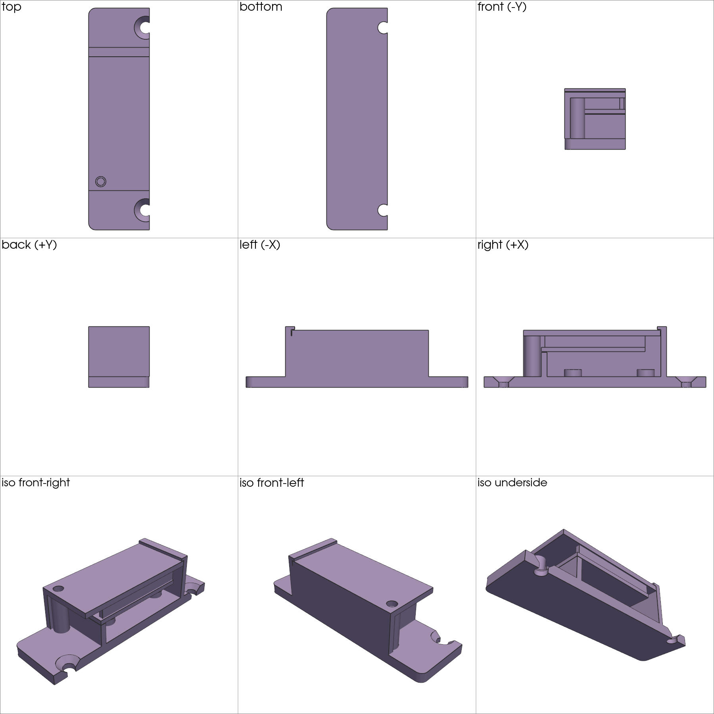
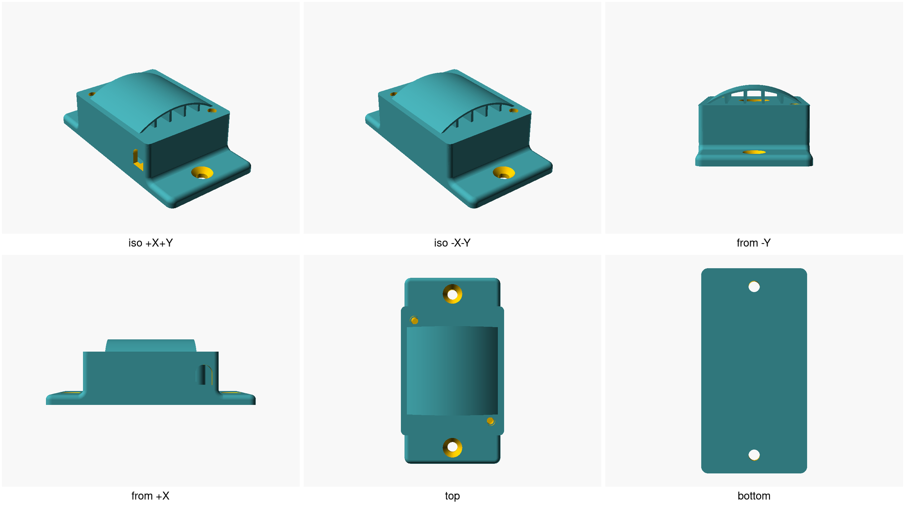

# BME688 cabin screen

Purpose: an open, printed case for one Adafruit BME688 on the cabin's wood panelling, near the
companionway but not at it. It keeps out dust, drips and the odd splash, and lets cabin air reach
the chip quickly. No membrane, no gasket, no IP rating. The sealed box is [bme688-halpi2](../bme688-halpi2/).



## How it breathes

Air enters a slot that faces down, rises between the cover and a baffle, turns over the baffle's
top and falls onto the chip. The test fires rays from the chip in fourteen directions; all are blocked.

## Overhead variant

For the underside of the panel above the berth by the nav station: plate up, two screws into the panel,
chip facing down. The panel is the roof. The cover is a floor with one 10 mm hole under a shallow arch that meets the floor at both
sides; four fins hold the arch up (arch and fins 0.8 mm, two lines of a 0.4 nozzle), each with a 3 mm gap either side of the hole so air can cross between them.
Air comes in the hole, runs out under the arch to its open ends, up and in. It prints floor-down with no
supports; no span is more than 5 mm (2.5 mm from its support). The cable leaves a window in one long wall.
32 x 62 x 16. Prints: `out/bme688-cabin-screen_overhead-body.3mf` and `_overhead-cover.3mf`; the cover takes
two M2.5 screws on a diagonal.



## Constraints (wall variant)

| | |
|---|---|
| Keeps out | dust, drips, a small chance of splash |
| Mount | two holes 51 mm apart: wood screws into the panelling, or the DIN clip (Printables 420009) |
| Cable | fixed, out the bottom through a notch in the chamber floor; Qwiic pigtail inside |
| Size | 32 x 62 x 17 |

## Parts

| Part | Which |
|---|---|
| Printed | body `out/bme688-cabin-screen_scad.3mf`, cover `out/bme688-cabin-screen_cover.3mf` |
| Board | Adafruit BME688, PID 5046, on four M2.5 self-tapping screws |
| Cover | hooks under the roof's lip; two M2.5 self-tapping screws at the bottom |

## Measured, and from what

Nothing is calipered. The board's size and holes are from Adafruit's board file, the mount pitch from
the DIN clip's model; both are in [`parts.md`](../../../parts.md). The pilot holes (2.1) and the baffle's
fit (0.3 a side) are guesses until the calibration table has numbers.

## Not confirmed

- How fast the reading follows the cabin air through the baffle.
- Whether the Qwiic plug and its wires fold into the 4 mm under the board.

## Build

```
uv run shop build projects/gas-sensors/bme688-cabin-screen
```
