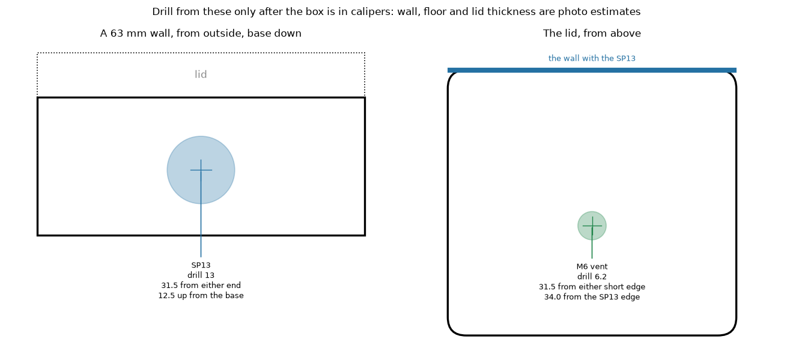

# BME688 box, wired straight to the HALPI2

Purpose: the first gas-sensor box. One Adafruit BME688 in the 63 x 58 x 35 ABS box, on a cable
under 300 mm to the HALPI2's own I2C pins. No extender, no second board, no custom PCB.
Boxes for the HALMET or for more sensors are separate projects beside this one.


## What changed from [small-box-sensors](../../small-box-sensors/)

| | small-box-sensors, environment box | This box |
|---|---|---|
| Boards | BME688 under an LTC4311 extender | BME688 alone |
| Vent | In the side wall, open to the whole box | In the lid, straight over the chip |
| Air the sensor shares with the vent | The whole box, about 70 cm3 | The pod's chamber, about 5 cm3 |
| Printed | Carrier and spacer | One pod |
| Wall | SP13 and vent side by side | SP13 alone, centred |

The pod is a block that lifts the board to 1.5 mm under the vent's thread and walls it in with a rim
that stops 1.5 mm short of the lid. Gas coming through the membrane has a small space to fill.
The rim is not a seal; its top gap and the plug notch leak into the rest of the box.

Screwed to a bulkhead by its base, the vent faces the room and the cable leaves downward.

## What goes in

| Part | Which |
|---|---|
| Board | Adafruit BME688, PID 5046 |
| Wall, 63 mm side | SP13 4-pin socket |
| Lid | M6 x 0.75 membrane vent, nut inside |
| Printed | the pod (`out/bme688-halpi2_scad.3mf`) |
| Inside wiring | Qwiic pigtail, 150 mm, the far end cut off (Adafruit 4397 or 4209) |
| Screws | 4 x M2.5 x 20 and nuts, 2 x M3 self-tappers for the floor bosses |
| Cable | 4-core, under 300 mm, SP13 plug on one end |
| HALPI2 end | one of its PG7 glands, four single Dupont sockets |

## Wiring


| SP13 pin | Signal | Qwiic wire | HALPI2 header pin |
|---|---|---|---|
| 1 | 3V3 | red | 1 |
| 2 | SDA | blue | 3 |
| 3 | SCL | yellow | 5 |
| 4 | GND | black | 9 |

- SP13 pin numbers are our convention, the same as small-box-sensors; keep them the same at both ends.
- Sensor box: the pigtail plugs into either socket on the board. Its cut ends solder to the SP13 socket's cups. Nothing is soldered to the board.
- Cable: SP13 plug soldered on the box end. The other end goes through a PG7 gland in one of the HALPI2's three blanked front-panel positions.
- HALPI2: one Dupont socket per wire, onto the 40-pin header.
- The HALPI2's panel also takes an SP13 in place of the gland, if the cable should unplug at both ends.

On the HALPI2 the bus is `/dev/i2c-1`. It needs `dtparam=i2c_arm=on`. The HALPI2's own controller is at 0x6d; the BME688 answers at 0x77.
The pull-ups are the board's 10 k and the compute module's 1.8 k.

## Drilling



The SP13 goes on the plain wall between the corner columns, under the gasket band, flats of its nut toward the floor.
The vent hole is over the chip, 5 mm off the lid's centre, away from the SP13 wall.

## Assembly order

1. Four M2.5 x 20 up through the pod from below, heads in their pockets.
2. Board onto the screws, chip up, inside the rim; nuts.
3. Pod onto the two floor bosses, two M3 self-tappers through the slots.
4. SP13 socket through the wall, nut inside. Solder the pigtail's four wires to its cups, then plug the pigtail into the board through the rim's notch.
5. Vent through the lid, nut inside. Lid on.

## Clearances (model, all on estimated box numbers)

| Between | mm |
|---|---|
| Chip top and the vent's thread | 1.5 |
| Rim top and the lid's underside | 1.5 |
| Stack screw tips and the lid's underside | 4.3 |
| SP13 rear and the pod | 7.8 |
| SP13 nut and the gasket band above / the floor below | 1.0 / 1.0 |
| Boss screw head, at the 43 pitch, and the pod's block | 4.2 |

`assembly.py` intersects every pair of components and the test fails on any overlap: 0 mm3.

## Measured, and from what

The box is the one in small-box-sensors, and its stand-in is that project's `box.scad`. Nothing is calipered.
That README lists the box guesses; these are the ones this design adds or leans on harder.

| Guess | Now | Check with |
|---|---|---|
| Lid plate thickness, and the lid's underside above the floor | 2.5, 29.5 | calipers; `lid_gap` and `seat_h` in `model.scad` follow from them |
| Lid's inside face | flat where the vent nut seats | the lid in hand |
| Floor boss pitch | 43; slots cover 35 to 51 | the gauge |
| Vent nut | 10 across flats x 2.5 | the part in hand |
| Qwiic plug past the board edge | 4 | the plug in hand; the notch is 7 wide |

Read, not guessed: the chip is at the board's exact centre and both sockets are on the chip's face, one at each short edge (Adafruit's BME680 board file, which the BME688 shares).

Print `out/bme688-halpi2_gauge.3mf` first: the pod's footprint 1 mm thick with 2 mm of rim.
It proves the boss pitch, the screw size, the board's holes and the board's fit in the rim.

## Not confirmed

- How far the gas reading lags the air outside the membrane. The small chamber is there to shorten it; no number yet.
- Whether a HAT on the HALPI2 leaves header pins 1, 3, 5 and 9 reachable.
- The current available from the HALPI2's 3V3 header pin. The BME688 draws up to 12 mA.
- The exact size of the HALPI2's panel positions; its documents say 6 mm or 13 mm holes, PG7 or SP13.
- The Signal K plugin `@oehoe83/signalk-raspberry-pi-bme680` does not state BME688 support.

## Build

`shop build` on its own does not reach this folder; name it:

```
uv run shop build projects/gas-sensors/bme688-halpi2
uv run python projects/gas-sensors/bme688-halpi2/assembly.py
uv run python projects/gas-sensors/bme688-halpi2/drawings.py
```

Sources for every part number are in [`parts.md`](../../../parts.md).
