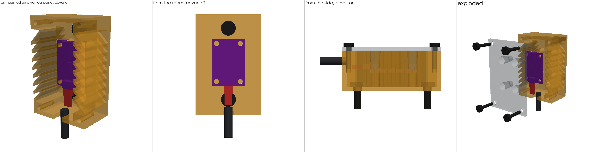
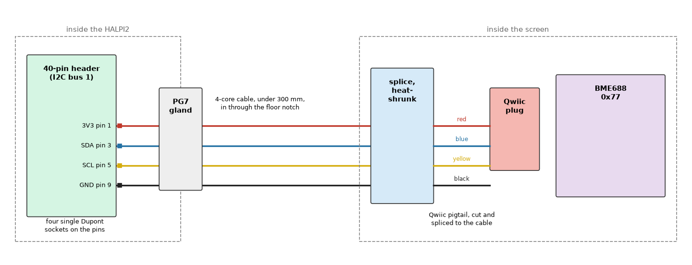

# BME688 screen, wired straight to the HALPI2

Purpose: the cabin gas sensor. One Adafruit BME688 in a printed louvred screen (a small Stevenson
screen) on a bulkhead, on a cable under 300 mm to the HALPI2's own I2C pins. PETG, no gaskets, nothing drilled.
It is open to the cabin air on purpose; it keeps fingers, drips and a straight line of sight off the board.



Back plate on the bulkhead, connector down. Ten slats a side slope down and out at 45 degrees; air crosses
the chip from one side to the other. The board hangs on four pegs, chip toward the room, and the cover's
four posts keep it there. The connector drops into a slot in the floor, so it is soldered on the bench.

## What goes in

| Part | Which |
|---|---|
| Board | Adafruit BME688, PID 5046, acrylic-coated with the chip and both sockets masked |
| Printed | body (`out/bme688-halpi2_scad.3mf`) and cover (`out/bme688-halpi2_cover.3mf`), PETG, no supports |
| Floor slot | SP13 4-pin socket; a PG7 gland fits the same slot |
| Inside wiring | Qwiic pigtail, 150 mm, the far end cut off (Adafruit 4397 or 4209) |
| Screws | 2 to 4 x M3 x 12 self-tappers for the cover, 2 x 4 mm pan-head wood screws for the bulkhead |
| Cable | 4-core, under 300 mm, SP13 plug on one end |
| HALPI2 end | one of its PG7 glands, four single Dupont sockets |

## Wiring



| SP13 pin | Signal | Qwiic wire | HALPI2 header pin |
|---|---|---|---|
| 1 | 3V3 | red | 1 |
| 2 | SDA | blue | 3 |
| 3 | SCL | yellow | 5 |
| 4 | GND | black | 9 |

- SP13 pin numbers are our convention, the same as small-box-sensors; keep them the same at both ends.
- Screen: the pigtail plugs into the board's lower socket. Its cut ends solder to the SP13 socket's cups. Nothing is soldered to the board.
- Cable: SP13 plug soldered on the screen end. The other end goes through a PG7 gland in one of the HALPI2's three blanked front-panel positions.
- HALPI2: one Dupont socket per wire, onto the 40-pin header.
- The HALPI2's panel also takes an SP13 in place of the gland, if the cable should unplug at both ends.

On the HALPI2 the bus is `/dev/i2c-1`. It needs `dtparam=i2c_arm=on`. The HALPI2's own controller is at 0x6d; the BME688 answers at 0x77.
The pull-ups are the board's 10 k and the compute module's 1.8 k.

## Assembly order

1. Solder the pigtail's four wires to the SP13 socket's cups.
2. Body to the bulkhead, two wood screws through the back plate. The gauge is the drill template.
3. SP13 socket into the floor slot from the front, nut inside, tightened.
4. Board onto the four pegs, chip out, plug end down. Plug the pigtail in.
5. Cover on, posts toward the board, M3 self-tappers into the corner posts.

## The owner's hands

Hours are guesses, not timed. Print time is not sliced yet.

| Step | Hours |
|---|---|
| Gauge: start the print, try the board, the SP13 and an M3 screw in it | 0.2 |
| Body and cover: start the print, pull the parts | 0.1 |
| Solder the pigtail to the SP13 socket | 0.3 |
| Solder the cable's plug, crimp or fit four Dupont sockets | 0.5 |
| Screw to the bulkhead, fit the board and cover | 0.2 |

## Clearances (model)

| Between | mm |
|---|---|
| Neighbouring slats, square to the slat | 2.3 |
| One slat's top edge above the next one's bottom edge | 3.8 |
| Chip top and the cover | 11.5 |
| Board's underside and the back plate | 10 |
| Cover post tips and the board | 0.3 |
| SP13 nut's corners and the chamber's sides | 2.2 |
| SP13 flange and the bulkhead | 4.3 |
| The pigtail's wires and the SP13's rear | 2.0 |
| Upper bulkhead screw's head and the board / the roof | 1.6 / 1.0 |

`assembly.py` intersects every pair of components and the test fails on any overlap: 0 mm3.

## Measured, and from what

Nothing is calipered. Read, not guessed: the board's outline and holes, the chip at its exact centre,
both sockets on the chip's face at the short edges (Adafruit's BME680 board file, which the BME688 shares).

| Guess | Now | Check with |
|---|---|---|
| Peg in the board's 2.5 holes | 2.1 | the gauge |
| Slot for the SP13 or a PG7 | 13.2 | the gauge |
| Pilot for an M3 self-tapper | 2.5 | the gauge |
| SP13 nut | 17 across flats x 3 | the part in hand; the chamber is 24 square |
| Board thickness | 1.6 | calipers; the cover posts' length follows |
| Bare board around each hole, for a post tip | 4.5 across | the board in hand |
| Qwiic plug past the board edge | 4 | the plug in hand |

Print `out/bme688-halpi2_gauge.3mf` first: the body without its slats and roof.

## Not confirmed

- Whether printed PETG gives off anything the gas channel reads. Nothing was found either way.
- Whether a HAT on the HALPI2 leaves header pins 1, 3, 5 and 9 reachable.
- The current available from the HALPI2's 3V3 header pin. The BME688 draws up to 12 mA.
- The exact size of the HALPI2's panel positions; its documents say 6 mm or 13 mm holes, PG7 or SP13.
- The Signal K plugin `@oehoe83/signalk-raspberry-pi-bme680` does not state BME688 support.

## Build

`shop build` on its own does not reach this folder; name it:

```
uv run shop build projects/gas-sensors/bme688-halpi2
uv run python projects/gas-sensors/bme688-halpi2/assembly.py
uv run python projects/gas-sensors/bme688-halpi2/drawings.py
```

Sources for every part number are in [`parts.md`](../../../parts.md). What may sit near the sensor: [enclosure-materials.md](../enclosure-materials.md).
