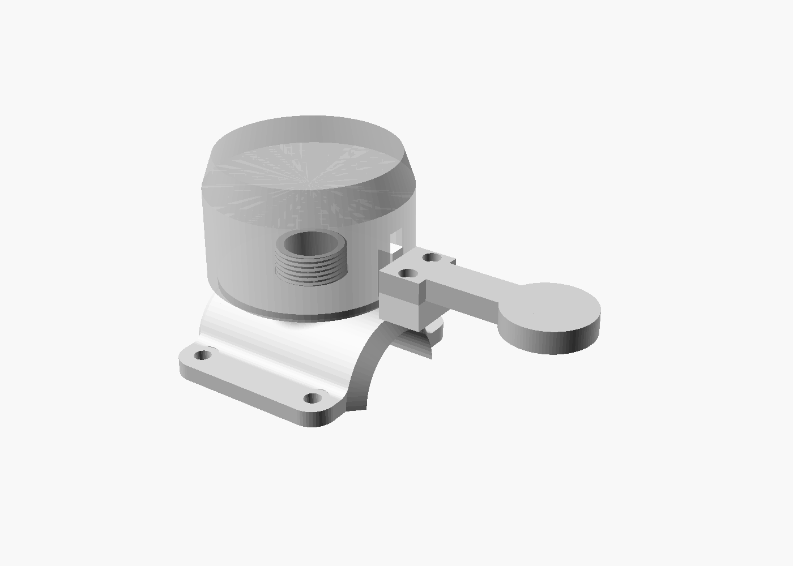

# GV30 lux sensor add-on

Purpose: an upward-facing lux sensor (VEML7700) on the windvane pulpit, carried by the Digital Yacht GV30
AIS/GPS antenna's existing mount, with no cable in sight.

First example modelled (`model.scad`: `ring`, `arm`, `assembly`), on the guesses marked in its
parameters. The barometer stays inside: cabin and outside pressure are the same
([outside-sensor-pod](../outside-sensor-pod/README.md)).

Guesses in the model: skirt inside radius 34 and wall 2.5, lead Ø4.5, ring 3 thick (costs that much
thread). Slot 7 x 25 is the owner's figure.

## Owner's constraints, 2026-11-18

- An add-on. The antenna clamp already on the boat is not reprinted.
- No new holes in the rail, no exposed cables.
- The lead enters the GV30's own base through its slot (about 7 wide, 25 long; owner's figure) and runs
  down the clamp's bore with the coax.
- A broken arm must be replaceable without pulling the coax. The coax goes through bare and is terminated
  (FME) after, so a pull means re-terminating.
- No threaded part between clamp and antenna beyond the antenna itself: the old mast extension snapped the
  clamp's stub where it met the base, and a threaded part spun onto the stub twists the cables in it.

## Direction (sketch, not yet agreed in detail)

A ring, about 3 mm, sandwiched between the stub's shoulder and the GV30's base. A tongue rises from it
into the GV30's slot and carries the lead into the antenna's cavity; the tongue also keys the ring to the
antenna, so the arm points where the slot does. The arm runs out sideways to the sensor head; the sensor
sits face up under a thin skin of white ASA, which is the diffuser.

Open:
- Whether the slot is open at the skirt's rim (assumed) or a closed window.
- Thread engagement left after the ring: the GV30's thread depth is not measured.
- Arm length against the dome's shadow: GV30 is 190 tall, Ø75 (vendor), dome height on the base not measured.
- Lead: thin patch-grade cat5e or flat cable, diameter not measured. VEML7700 board not in hand.

## Measured from the owner's file

`ref/clamp-upper.stl` is the clamp's top half from "antenna mount for oversized tubing.3mf" (2026-03),
unchanged, in the file's own coordinates (split plane z = -22, tube along X). The print on the boat may
differ slightly.

| Feature | Value |
|---|---|
| Cradle | Ø40 |
| Stub thread | 1"-14, OD 25.2, about 13 long, top at z = 22 |
| Bore | Ø19 |
| Clamp body | 76.2 along the tube, 81.5 across the flanges |
