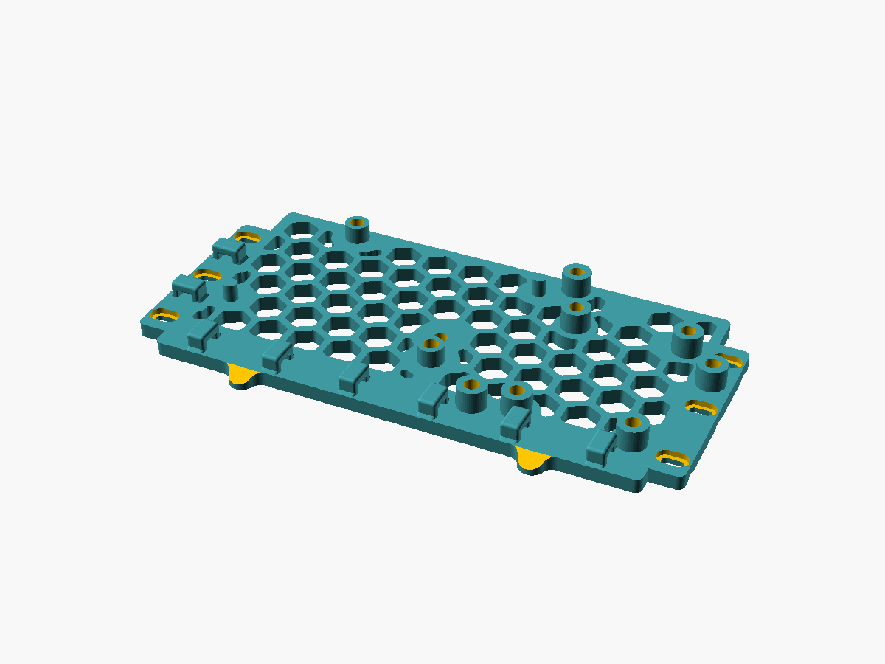

# HALMET adapter plate for the 158x90x60 waterproof box

Purpose: hold a Hat Labs HALMET board in Hat Labs' pre-drilled 158x90x60 mm
enclosure (SKU ECK-PW158-H). The board's two M3 slots match nothing in the box,
so a printed frame screws to the box's six holed floor bosses, rests on its
four no-hole posts, and carries two standoffs for the board. Box photos and
inside measurements: [`enclosure/`](enclosure/README.md).

## Status

- [x] Board geometry, from the KiCad file
- [x] 2D overlay (`overlay.py`, `out/overlay.png`; drawn before the owner's numbers, shows the earlier solid plate)
- [x] `model.scad`, tests, render, 3MF and laser DXF
- [x] Rest pads on the four no-hole posts, zip-tie slots, underside pockets over the bosses (`model.scad`, tests)
- [ ] Build and test the post/tie revision; refresh `out/` and draw `overlay.py` from the built DXF
- [ ] Fit check in the box, then tune the box parameters
- [ ] Final print or cut, fitted

## Known, and from what

Board coordinates: origin at the board's lower-left bounding corner, terminal
blocks on the left, USB tab on the right, component side up.

| Value | mm | Source |
|---|---|---|
| Board bounding size | 89 x 58 | `HALMET.kicad_pcb`, hatlabs/HALMET-hardware |
| Corner cut-outs | concave, radius 8.5, at three corners | same |
| USB tab | right edge steps in 6 mm above y = 24.7 | same |
| Mounting slot 1 centre | (22.75, 51.5) | same |
| Mounting slot 2 centre | (67.25, 6.5) | same |
| Slot size | 4.8 x 3.2 oval, long axis at 45 degrees, unplated | same |
| Slot to slot | 44.5 across, 45.0 up, 63.3 direct | same |
| Underside | solder jumpers and through-hole pin stubs only | same |
| Box outside | 158 x 90 x 60 | vendor page |
| Box wall holes | six 13 mm, four with PG7 plugs, all on one long wall | vendor page and photos |

## Estimated

The box is too deep for calipers to reach the bosses squarely, so these are the
owner's eyeball numbers. The frame is built to be tuned from a fit check.

| Parameter | Now | Source |
|---|---|---|
| `boss_span` | 136 | owner, between 130 and 140 |
| `boss_pitch` | 21 | owner, approximate |
| Boss height | 3.5 | owner; read as height, not hole diameter (agent's reading) |
| Solid post height | 2 | owner; lower than the bosses, so the frame passes over them |
| Inner floor | 151 x 83 | owner |
| Floor to lowest gland nut | 2 to 3 | owner; the frame stays 14 mm clear of that wall in plan |
| `screw_d` | 3.4 | guess; the boss hole diameter is unmeasured |

## Design

- An open frame, 144 x 57.5 x 3: two end bars over the bosses, two rails under
  the board's slot lines, one cross tie. 11 cm3, against 24.5 for a solid plate.
- Each end bar has three fork slots, open toward the box wall, so a boss
  anywhere within `slot_reach` (4 mm) of `boss_span` still takes its screw.
- Two standoffs, 6 mm, at the board's slot centres, each with an M3 heat-set
  insert. Two plain rests on the other diagonal so pushing a plug into a
  terminal block does not rock the board.
- Four pads reach out to the no-hole posts, 75 wide overall. The posts sit
  1.5 below the bosses, so the frame is 4.5 thick and its underside is
  pocketed 1.5 deep over each boss: Z = 0 rests on the posts, the pocket
  ceilings sit on the bosses. Set `post_h` equal to `boss_h` for a flat 3 mm
  frame.
- Zip-tie strain relief: slot pairs, the tie looping under the frame. Three on
  a bar along the gland wall, two on the left end bar beside the terminal
  blocks. Positions are lists at the top of the model.
- `board_dy` moves the board, rails and standoffs together, away from the
  gland-nut wall.

## Fit check

Set `part = "gauge"` with `mode = "3d"` for a 0.8 mm print of the same outline,
or cut the frame at Z = 0.8 in the slicer. Lay it on the bosses, read where
each boss sits in its fork, and change `boss_span` and `boss_pitch` to centre
them.

## Laser

`out/halmet-enclosure-mount_scad.dxf` is the same outline with M3 through
holes where the standoffs go; use two loose 6 mm M3 spacers. 3 mm acrylic
cuts cleanly but cracks at a fork tine if a screw is overtightened; a printed
frame is the better part for a boat.
