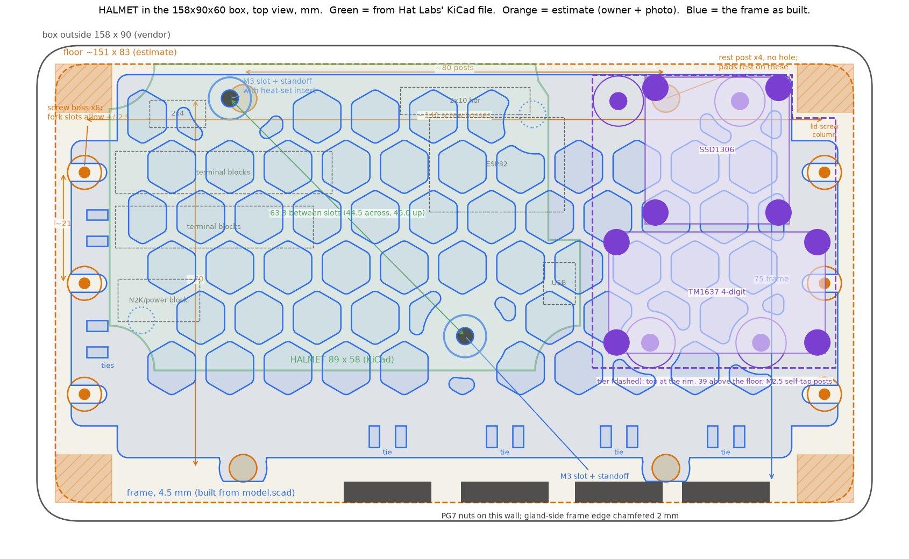
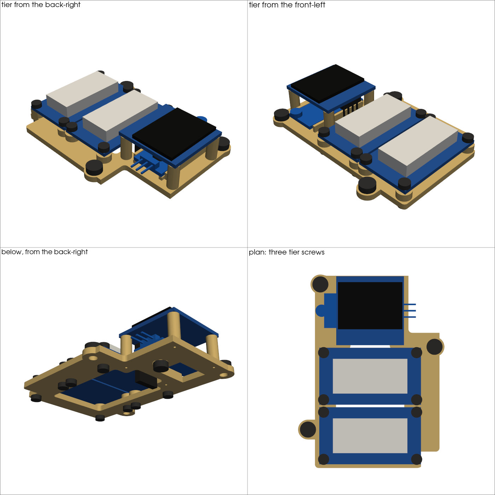
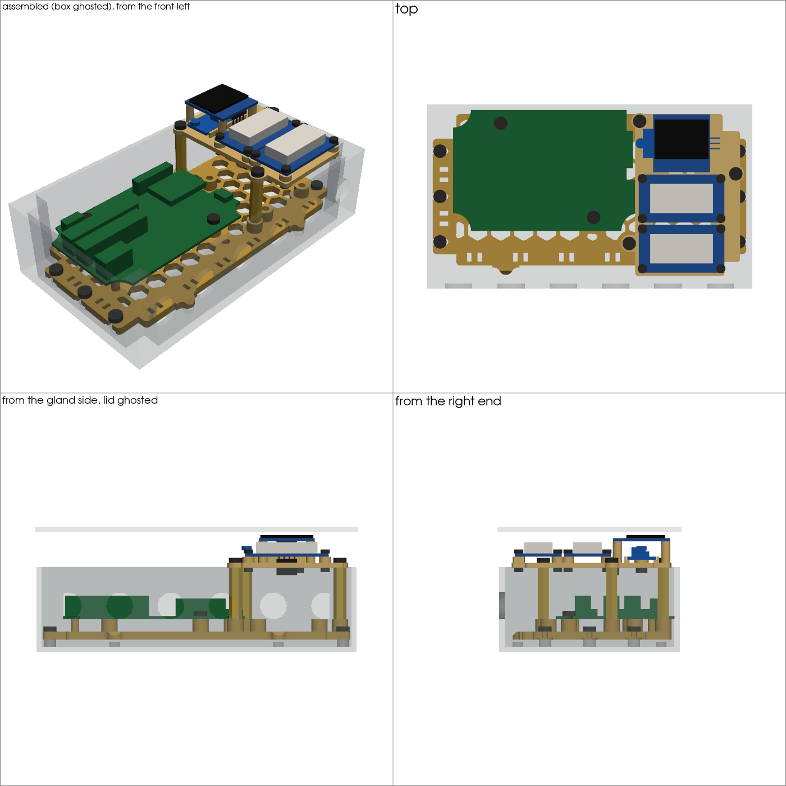
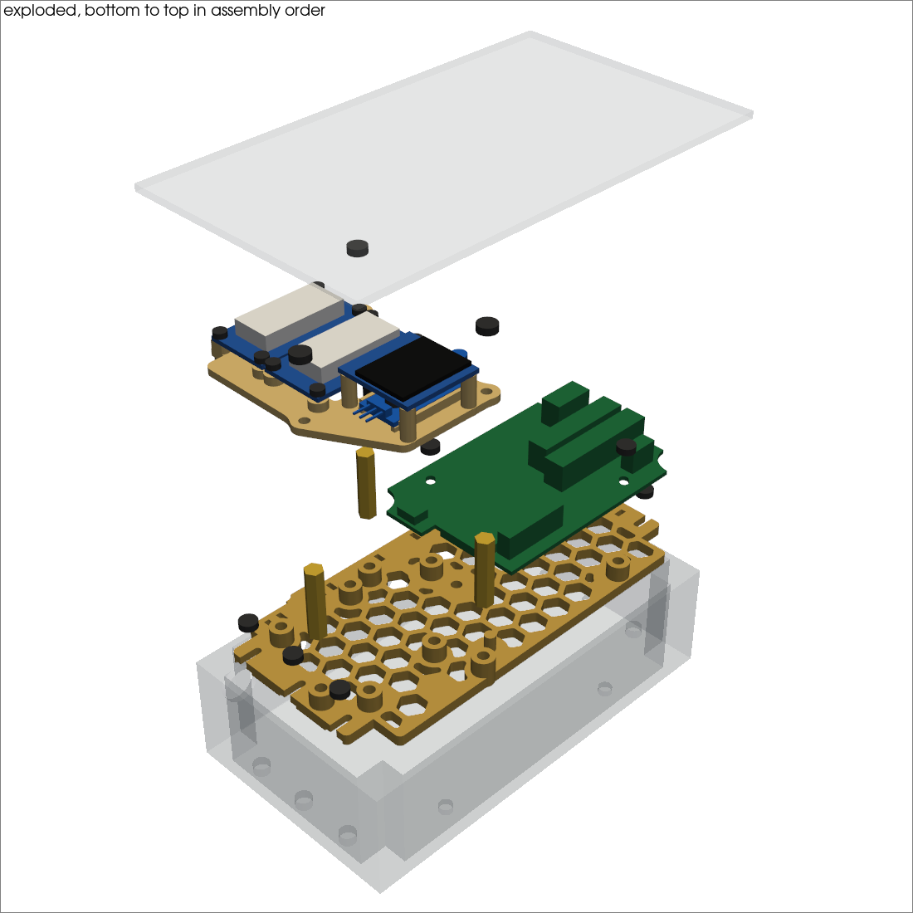

# HALMET adapter plate for the 158x90x60 waterproof box

Symphony: [`firmware/halmet`](https://github.com/mark-brannan/symphony/tree/main/firmware/halmet), [`reference/halmet_firmware.md`](https://github.com/mark-brannan/symphony/tree/main/reference/halmet_firmware.md), [`diagrams/electrical/chart-table-cabinet.drawio`](https://github.com/mark-brannan/symphony/tree/main/diagrams/electrical/chart-table-cabinet.drawio)

Purpose: hold a Hat Labs HALMET board in Hat Labs' pre-drilled 158x90x60 mm
enclosure (SKU ECK-PW158-H). The board's two M3 slots match nothing in the box,
so a printed frame screws to the box's six holed floor bosses, rests on its
four no-hole posts, and carries two standoffs for the board. Box photos and
inside measurements: [`enclosure/`](enclosure/README.md).

## Status

- [x] Board geometry, from the KiCad file
- [x] Board geometry drawn against the box (`overlay.py`)
- [x] `model.scad`, tests, render, 3MF and laser DXF
- [x] Rest pads on the four no-hole posts, zip-tie slots, underside pockets over the bosses (`model.scad`, tests)
- [x] Build and test the post/tie revision; `overlay.py` draws the built DXF (`out/overlay.png`)
- [x] Raised SSD1306 display posts (`model.scad`, tests, overlay)
- [x] Hex-lightened plate replaces the open frame; every display post on solid plate
- [ ] Fit check in the box, then tune the box parameters
- [ ] Final print or cut, fitted

## Known, and from what

Board coordinates: origin at the board's lower-left bounding corner, terminal
blocks on the left, USB tab on the right, component side up.

| Value | mm | Source |
|---|---|---|
| Board bounding size | 89 x 58 | `HALMET.kicad_pcb`, hatlabs/HALMET-hardware |
| Corner cut-outs | concave, radius 8.5, at three corners | same |
| USB tab | right edge steps in 6 mm above y = 24.7 | same |
| Mounting slot 1 centre | (22.75, 51.5) | same |
| Mounting slot 2 centre | (67.25, 6.5) | same |
| Slot size | 4.8 x 3.2 oval, long axis at 45 degrees, unplated | same |
| Slot to slot | 44.5 across, 45.0 up, 63.3 direct | same |
| Underside | solder jumpers and through-hole pin stubs only | same |
| Box outside | 158 x 90 x 60 | vendor page |
| Box wall holes | six 13 mm, four with PG7 plugs, all on one long wall | vendor page and photos |

## Estimated

The box is too deep for calipers to reach the bosses squarely, so these are the
owner's eyeball numbers. The frame is built to be tuned from a fit check.

| Parameter | Now | Source |
|---|---|---|
| `boss_span` | 143 | 140 printed, its screws sat at the fork mouths (photo); +3, 1.5 a side |
| `boss_pitch` | 21.7 | 21 printed too tight, 22.5 a touch wide, 22 printed; 21.7 next |
| `end_ext` | 3 | owner; each end bar 3 mm longer (6 in all) |
| `slot_d` | 2.8 | M2.5 clearance for the six screws into the bosses |
| Boss height | 3.5 | owner; read as height, not hole diameter (agent's reading) |
| Solid post height | 2 | owner; lower than the bosses, so the frame passes over them |
| Inner floor | 151 x 83 | owner |
| Lid-screw column | round, in each corner; inner face ~11 from the outside wall square to it, ~11.5 on the diagonal from the outside corner; wall ~2.5. From the 158 x 90 outside: inner face at X ±68, Y ±34 | owner, calipers from outside |
| Floor to lowest gland nut | 2 to 3 | owner; the frame stays 14 mm clear of that wall in plan |
| `screw_d` | 3.4 | M3 clearance for the tier's standoff screws; guess |

## Design

- One plate, 148 x 77, lightened by a hex lattice: 9 mm cells, 2 mm walls, a
  2 mm rim. Cells are clipped where they meet a solid island (screw ends, rest
  pads, standoffs, rests, tier bosses, tie slots). 25.8 cm3 measured from the
  STL, against 11 for the earlier open frame; the plate is the stiffer of the two.
  `hex_flat`, `hex_web`, `rim_w` tune it.
- Each end bar has three fork slots, open toward the box wall, so a boss
  anywhere within `slot_reach` (outward) or `slot_reach + slot_in` (inward) of `boss_span` still takes its screw.
- Two standoffs, 6 mm, at the board's slot centres, each with an M3 heat-set
  insert. Two plain rests on the other diagonal so pushing a plug into a
  terminal block does not rock the board.
- Flat underneath, resting on the six bosses. Four pads reach over the no-hole posts, which sit
  about 1 mm lower; a 1 mm stick-on pad on each closes the gap if the plate rocks.
- Zip-tie strain relief: slot pairs, the tie looping under the frame. Six
  along the gland-side edge, chamfered underneath where the tie turns, two on the left end beside the terminal blocks. Positions are lists at the top of the model.
- `board_dy` moves the board, rails and standoffs together, away from the
  gland-nut wall.
- Display tier, a separate flat print (`part-tier-row.scad`), no supports: two TM1637s on 3 mm printed bosses and
  the SSD1306 on four 10 mm M2 F/F standoffs through plain 2.5 mm holes, in one column. It sits on three 25 mm M3 F/F standoffs in heat-set inserts in
  10 mm pads on the plate; three M3 from above hold it down.
- Four more insert pads (`mid_cols`) wait for a future middle tier.
- Light sensor, on the tier under the OLED: the LM393 module ([`parts.md`](../../parts.md)) in a cradle
  between the OLED's post rows, photocell end out past the OLED's left edge so the cell sees the lid.
  It sits on edge ledges clear of its solder, side walls stop it turning (the back one starts past the back-left tier screw head), and one M3 goes up from under the tier
  through its hole, a nut on the board top; a round recess in the tier's underside takes the screw head (a nut, not a heat-set insert: the hole is 3.4, the insert 4.0). Bend the header pins down.

## Assembly

`assembly.py` renders the parts in the box from `assembly.scad`. Boards are boxes; part heights,
are guesses.

Order, on the bench then in the box:

1. Tier: light sensor into its cradle, one M3 from under the tier and a nut on top; then the TM1637s onto their bosses, M2.5 up from under the tier, and the OLED.
2. Plate, out of the box: tier standoffs into the pad inserts, any time.
3. Plate into the box, six screws through the fork slots.
4. HALMET onto its standoffs, two screws from above.
5. Tier onto its standoffs, three screws from above. Then wire everything and fit the lid.

Two fixed steps: the tier covers the right-hand floor screws,
so the tier comes off before the plate. The standoffs come off only with the plate out of the box.
The tier overhangs the HALMET's right edge by 2 mm, so the HALMET comes off with the tier off; its left edge is 1.5 mm from the left floor-screw heads.

## Wiring

Pin numbers are from `HALMET.kicad_pcb` (hatlabs/HALMET-hardware) pad nets, read 2026-11-17.
GPIO picks avoid the strapping pins (5, 12, 15) and GPIO 33, which symphony-halmet drives as a test pulse.

| From | HALMET connector, pin | Net |
|---|---|---|
| Supply 0 V (N2K NET-C) | power/N2K 4-pin, 1 | GND |
| Supply +5 to 32 V (N2K NET-S) | power/N2K 4-pin, 2 | V+ |
| N2K CAN_H, CAN_L | power/N2K 4-pin, 3, 4 | empty off N2K |
| DS18B20 GND | 1-Wire 3-pin (not fitted from the factory), 1 | GND |
| DS18B20 VDD | 1-Wire, 2 | 3V3 |
| DS18B20 DQ | 1-Wire, 3 | GPIO 4, 2.2 k pull-up on the board |
| SSD1306 GND, VCC, SCL, SDA | I2C 4-pin socket, 1, 2, 3, 4 | GND, 3V3, GPIO 22, GPIO 21 |
| TM1637 VCC | GPIO 2x10, 1 | 3V3 |
| TM1637 GND | GPIO 2x10, 3 | GND |
| TM1637 DIO | GPIO 2x10, 5 | GPIO 17 |
| TM1637 CLK | GPIO 2x10, 7 | GPIO 16 |
| LM393 VCC | GPIO 2x10, 20 | 3V3 |
| LM393 GND | GPIO 2x10, 18 | GND |
| LM393 DO | GPIO 2x10, 10 | GPIO 34, input only, no internal pull-up |

The 1-Wire header order is G, V, D; the one-wire bus board's terminals are G, D, V, so the cable between them crosses V and D.
The A and D input terminals sit on the isolated side (their own ground); none of these parts uses them.

## Fit check

`out/halmet-enclosure-mount_gauge.3mf` is the same outline as a 1 mm plate with big windows;
2 mm stubs, holed through, mark the standoffs, rests and tier and mid-tier pads. Lay it on the bosses, read where
each boss sits in its fork, and change `boss_span` and `boss_pitch` to centre
them.

`out/halmet-enclosure-mount_tier-gauge.3mf` is two hollow, square-sided plates, one for the segment
display's holes and one for the OLED's (not the photocell). Every size is a parameter at the top of
`part-tier-gauge.scad` (Customizer): hole spacing, hole diameter, margin, thickness, rim. Plate size is
hole spacing + hole diameter + 2 x margin, so calipering it checks the print against the numbers.

## Laser

`out/halmet-enclosure-mount_scad.dxf` is the same outline with M3 through
holes where the standoffs go; use two loose 6 mm M3 spacers. 3 mm acrylic
cuts cleanly but cracks at a fork tine if a screw is overtightened; a printed
frame is the better part for a boat.
