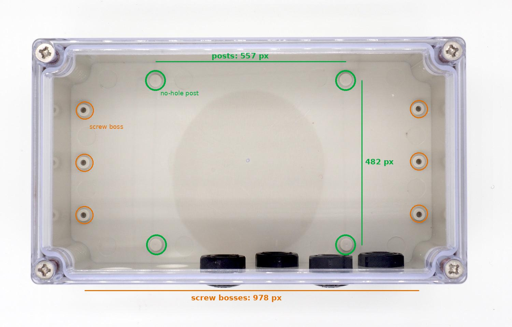

# Enclosure: Hat Labs waterproof box 158 x 90 x 60, pre-drilled

Hat Labs SKU ECK-PW158-H,
[vendor page](https://shop.hatlabs.fi/products/waterproof-enclosure-158x90x60-mm-pre-drilled-holes).
No maker's drawing exists; every inside number below is an estimate.

Green: four no-hole rest posts. Orange: six holed screw bosses.

## Measurements

Origin at the centre of the floor, X along the length, -Y toward the gland wall.

| Feature | Owner (calipers / eye) | Photo (scaled) | Model uses |
|---|---|---|---|
| Outside | 158 x 90 x 60 (vendor) | | |
| Inner floor | ~151 x ~83 | | |
| Holed bosses, end to end | 130 to 140, best 136 | 136 to 140 | `boss_span` 136 |
| Holed bosses, neighbour pitch | ~21 | 21.3 to 22.0 | `boss_pitch` 21 |
| Holed boss height | ~3.5 | | `boss_h` 3.5 |
| Holed boss outside diameter | | ~6 | `boss_d` 6 |
| Rest posts, along the length | ~80 | 77.4 to 79.9 | `post_dx` 80 |
| Rest posts, across the width | ~70 | 67.0 to 69.1 | `post_dy` 70 |
| Rest post height | ~2 | | `post_h` 2 |
| Rest post diameter | | ~5 | |
| Floor to lowest gland nut | 2 to 3 | | |
| Lid-screw column, each corner, full height: inner edges | | x 64.8, y 32.4 | `lid_col_x`, `lid_col_y` |
| Gland nut inner face from centre | | ~37.5 | frame stays inside 37.5 |

The photo has no scale of its own. Its range comes from scaling by two of
the owner's numbers: the low end assumes the bosses are 136 apart, the high
end assumes the floor is 151 wide. The two disagree by 3 %, so at least one
owner number is off by about that much. Ratios in the photo hold either way:
post spacing along the length is 0.569 of the boss span, and across the
width 0.865 of the post spacing along the length.

`annotate.py` redraws the annotated photo and prints both scalings:
`uv run --no-project --with pillow python annotate.py vendor-top.jpg floor-annotated.jpg`.
