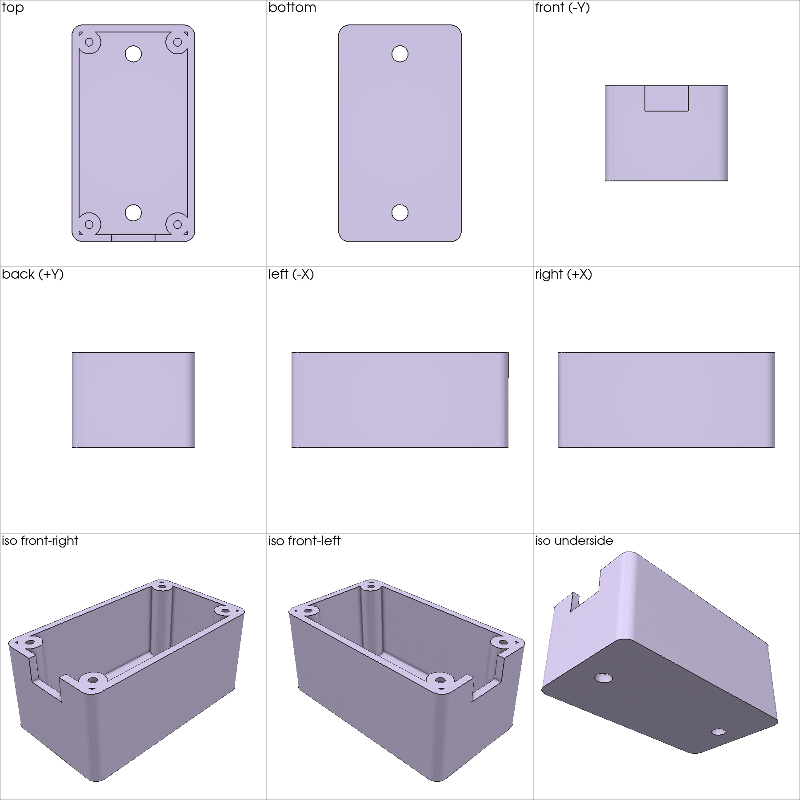

# HALMET piezo pod

Symphony: [`firmware/halmet`](https://github.com/mark-brannan/symphony/tree/main/firmware/halmet), [`reference/halmet_firmware.md`](https://github.com/mark-brannan/symphony/tree/main/reference/halmet_firmware.md), [`diagrams/electrical/chart-table-cabinet.drawio`](https://github.com/mark-brannan/symphony/tree/main/diagrams/electrical/chart-table-cabinet.drawio)

Purpose: hold the HALMET's alarm buzzer and the XY-MOS trigger module that switches it, high on a
vertical engine-room bulkhead, out of the splash and the worst of the oil and dust. A plain box and a
screwed lid; no seal. The buzzer sits in the lid, stacked over the module, port facing out.

## Status

- [x] Schematic (`piezo-alarm.drawio`)
- [x] Box and lid: `model.scad`, `part-lid.scad`, tests, renders, 3MFs
- [ ] Photo of the XY-MOS board: terminal layout, input resistor, pull-down
- [ ] Buy the 12 V buzzer
- [ ] Print box and lid; fit, wire, screw up

## Known, and from what

Nothing is measured. The box gives room instead.

| Parameter | Now | Source |
|---|---|---|
| XY-MOS module | 34 x 17 x 12 | seller listings, on hand, not calipered |
| `buzzer_d`, `buzzer_h` | 12, 9.5 | 12 mm active buzzer class, typical; unbought |
| `buzzer_fit` | 0.2 a side | guess; push fit, glue if loose |
| `pilot_d`, `lid_hole_d` | 2.2, 3.2 | M2.5 self-tapping; printed holes come out small |
| `mount_d` | 4.5 | #8 or M4 pan head |

## Design

- Box 34 x 60 x 26.4, 15.7 cm3; lid 34 x 60 x 2.4 plus a 5 mm collar, 5.0 cm3. PETG.
- The module lies on the floor on foam tape. The buzzer pushes into the collar on the lid's inside;
  a 9 mm window, smaller than the buzzer, stops it and lets the sound out.
- Four M2.5 self-tapping screws into corner bosses hold the lid.
- Two screws through the floor, from inside, hold the box to the bulkhead, clear of the module's ends.
- Two cables (HALMET signal, boat 12 V) enter through a 12 x 7 notch in the bottom wall, run out to the
  rim; the lid closes it. Tie them to the bulkhead below the box for strain relief.
- Print box floor down and lid outer face down. Nothing overhangs.

## Wiring

Source: [`piezo-alarm.drawio`](piezo-alarm.drawio). GPIO 32 HIGH turns on a low-side N-FET that sinks the buzzer's negative lead off V+, as symphony's firmware has it.
The gate resistor, the 100 k gate-to-source pull-down, the FET, the 1N4148 and the buzzer all sit in the pod in the engine room; with the pull-down there, a cut cable leaves the buzzer off.
The diode, cathode to V+, is harmless on a piezo-type buzzer and needed only if the buzzer turns out to be magnetic.
Intended parts, not yet bought: AO3400A FET (SOT-23, logic-level at 2.5 V), a 12 V active buzzer of the 12 mm class.
V+ reaches the inside of the HALMET box only at the power/N2K terminal, pin 2, ahead of the HALMET's own fuse (F301); no header or other terminal pin carries it, so X1's V+ lead shares that terminal with the supply wire.
Inside the HALMET box, F1, a 0.5 A inline fuse, protects the field cable's V+ lead, which the HALMET's own fuse does not cover; R3, 1 k inline in heatshrink at X1, limits current into GPIO 32 from a fault or ESD on the cable.
HALMET pin numbers are from `HALMET.kicad_pcb` (hatlabs/HALMET-hardware) pad nets, read 2026-11-23.

| From | To | Net |
|---|---|---|
| HALMET power/N2K 4-pin, 2 (shared with the supply wire) | F1 0.5 A inline fuse, then X1 pin 1 | V+ |
| HALMET GPIO 2x10, 8 | R3 1 k inline, in heatshrink at X1, then X1 pin 2 | GPIO 32 |
| HALMET GPIO 2x10, 12 | X1 pin 3 | GND |
| X1 pins 1, 2, 3 | field cable, 3 conductors, to engine room, length unknown | V+, GPIO 32, GND |
| Field cable | pod P1 pins 1, 2, 3 | V+, GPIO 32, GND |
| P1 pin 1 | buzzer +, D1 cathode | V+ |
| P1 pin 2 | R1 100 Ω, then Q1 gate; R2 100 k gate to source | GATE |
| P1 pin 3 | Q1 source, R2 | GND |
| Q1 drain | buzzer −, D1 anode | BZ_NEG |
