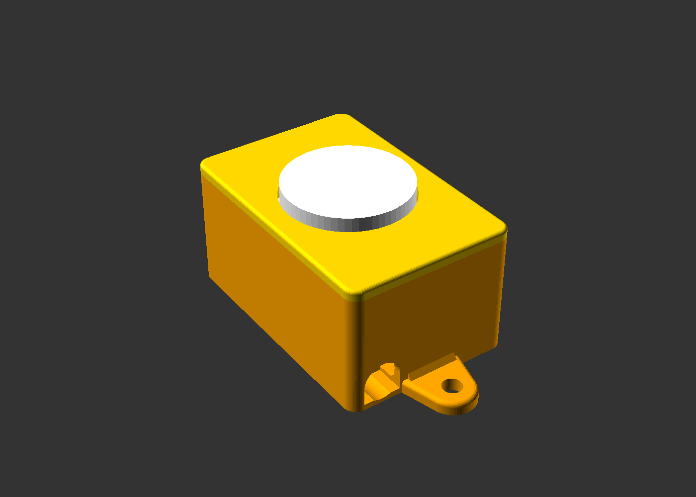
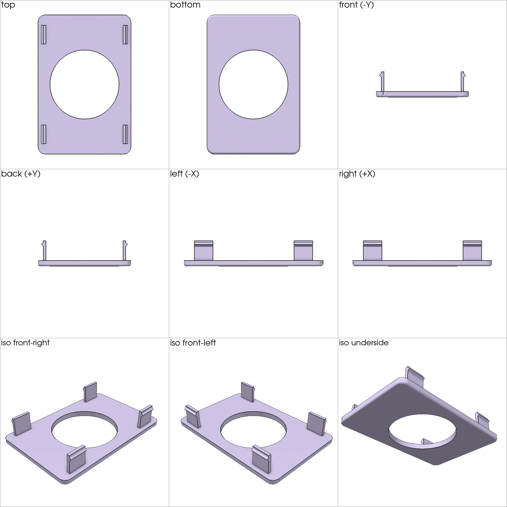
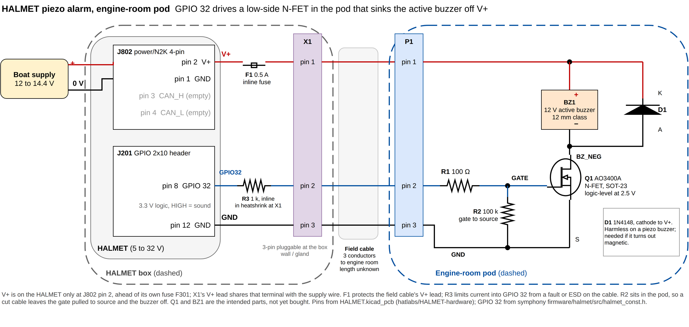

# HALMET piezo pod

Symphony: [`firmware/halmet`](https://github.com/mark-brannan/symphony/tree/main/firmware/halmet), [`reference/halmet_firmware.md`](https://github.com/mark-brannan/symphony/tree/main/reference/halmet_firmware.md), [`diagrams/electrical/chart-table-cabinet.drawio`](https://github.com/mark-brannan/symphony/tree/main/diagrams/electrical/chart-table-cabinet.drawio)

Purpose: hold the HALMET's alarm buzzer and the XY-MOS trigger module that switches it, high on a
vertical engine-room bulkhead, out of the splash and the worst of the oil and dust. A plain box and a
screwed lid; no seal. The buzzer sits in the lid, stacked over the module, port facing out.

## Status

- [x] Schematic (`piezo-alarm.drawio`)
- [x] Box and lid: `model.scad`, `part-lid.scad`, tests, renders, 3MFs
- [x] XY-MOS board calipered and photographed
- [ ] Solder a 2-pin header to the module's J1 trigger pads, on the bench
- [ ] Buy the 12 V buzzer
- [ ] Print box and lid; fit, wire, screw up

## Known, and from what

The module is calipered; the buzzer is not bought, so the box gives it room.

| Parameter | Now | Source |
|---|---|---|
| XY-MOS module | 33.8 x 16.7 x 12 | owner, caliper; height from seller listings |
| `buzzer_d`, `buzzer_h` | 12, 9.5 | 12 mm active buzzer class, typical; unbought |
| `buzzer_fit` | 0.2 a side | guess; push fit, glue if loose |
| `pilot_d`, `lid_hole_d` | 2.2, 3.2 | M2.5 self-tapping; printed holes come out small |
| `mount_d` | 4.5 | #8 or M4 pan head |

## Design

- Box 34 x 60 x 26.4, 15.7 cm3; lid 34 x 60 x 2.4 plus a 5 mm collar, 5.0 cm3. PETG.
- The module lies on the floor on foam tape. The buzzer pushes into the collar on the lid's inside;
  a 9 mm window, smaller than the buzzer, stops it and lets the sound out.
- Four M2.5 self-tapping screws into corner bosses hold the lid.
- Two screws through the floor, from inside, hold the box to the bulkhead, clear of the module's ends.
- Two cables (HALMET signal, boat 12 V) enter through a 12 x 7 notch in the bottom wall, run out to the
  rim; the lid closes it. Tie them to the bulkhead below the box for strain relief.
- Print box floor down and lid outer face down. Nothing overhangs.

## Wiring

Source: [`piezo-alarm.drawio`](piezo-alarm.drawio). GPIO 32 HIGH triggers the XY-MOS dual-MOSFET trigger module (on hand; trigger 3.3 to 20 V), which switches the buzzer low-side off boat 12 V, as symphony's firmware has it.
Nothing is added inside the HALMET box: only GPIO 32 and GND leave it, through a 2-pin pluggable at the gland, on a 2-core cable to the engine room.
The pod's 12 V comes from a boat 12 V feed near the pod, fused at the tap, on its own 2-core cable.
The module's terminal names are the sellers' listing, and its input resistor and gate pull-down are unverified; a photo of the board settles both.
D1, a 1N4148 across the buzzer, cathode to OUT+, sits in the OUT screw terminals with the buzzer leads, no solder. It is harmless on a piezo-type buzzer and needed only if the buzzer turns out to be magnetic.
Trigger GND and VIN− meet inside the module. The HALMET's J201 GND is common with its supply ground: J201 pins 3, 12, 14, 16, 18 and power/N2K pin 1 are all one net, `GND`, in `HALMET.kicad_pcb` (the isolated `GND1` serves only the A and D inputs). So the HALMET's ground and the boat negative join in the module as well as at the HALMET's supply.
Intended buzzer, not yet bought: 12 V active buzzer, 12 mm class.
HALMET pin numbers are from `HALMET.kicad_pcb` (hatlabs/HALMET-hardware) pad nets, read 2026-11-23.

| From | To | Net |
|---|---|---|
| HALMET GPIO 2x10, 8 | X1 pin 1, at the gland | GPIO 32 |
| HALMET GPIO 2x10, 12 | X1 pin 2 | GND |
| X1 pins 1, 2 | cable A, 2-core, to engine room, length unknown | GPIO 32, GND |
| Cable A | module TRIG/PWM, GND | GPIO 32, GND |
| Boat 12 V +, fused at the tap | cable B, then module VIN+ | 12 V |
| Boat 12 V − | cable B, then module VIN− | boat negative |
| Module OUT+ | buzzer +, D1 cathode | 12 V |
| Module OUT− | buzzer −, D1 anode | switched negative |
