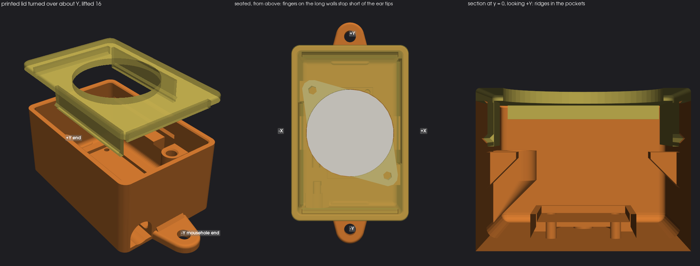
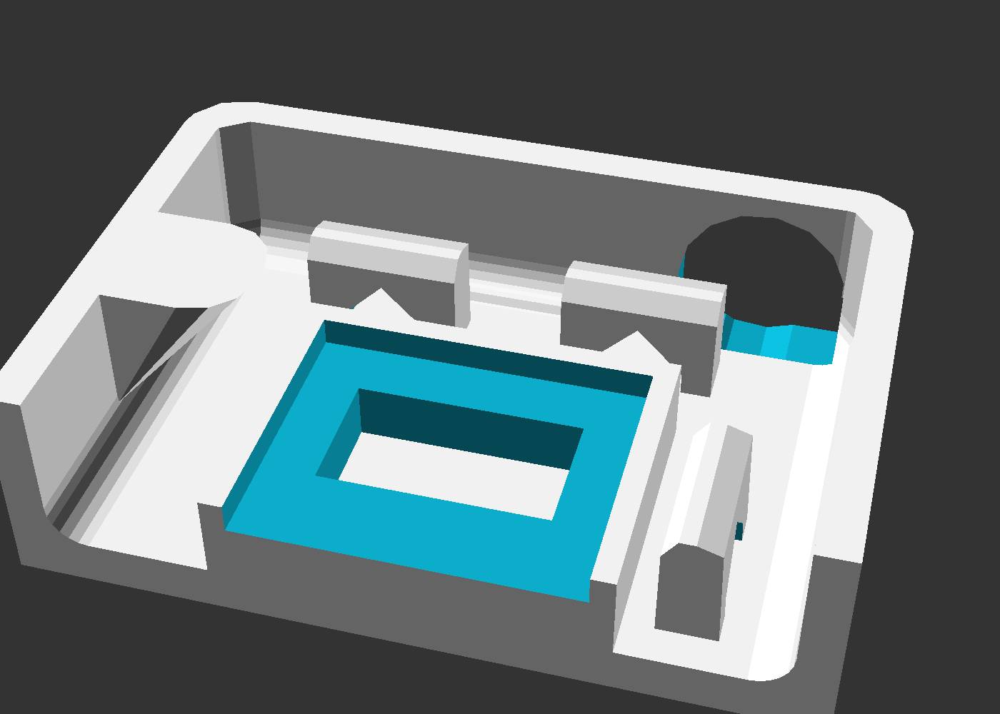

# HALMET piezo pod

Symphony: [`firmware/halmet`](https://github.com/mark-brannan/symphony/tree/main/firmware/halmet), [`reference/halmet_firmware.md`](https://github.com/mark-brannan/symphony/tree/main/reference/halmet_firmware.md), [`diagrams/electrical/chart-table-cabinet.drawio`](https://github.com/mark-brannan/symphony/tree/main/diagrams/electrical/chart-table-cabinet.drawio)

Purpose: hold the HALMET's alarm buzzer and the XY-MOS trigger module that switches it, high on a
vertical engine-room bulkhead, out of the splash and the worst of the oil and dust. A plain box and a
snap-on lid; no seal. The flanged buzzer sits inside, stacked over the module; only its round body comes out through the lid, so its leads stay inside.

`show = "cutaway"` in `model.scad` renders the section; `"exploded"` the exploded view.

## Status

- [x] Schematic (`piezo-alarm.drawio`)
- [x] Box and lid: `model.scad`, `part-lid.scad`, tests, renders, 3MFs
- [x] XY-MOS board calipered and photographed
- [ ] Solder a 2-pin header to the module's J1 trigger pads, on the bench
- [ ] Print box and lid; fit, wire, screw up

## Known, and from what

Module calipered; buzzer measured by the owner, partly by eye.

| Parameter | Now | Source |
|---|---|---|
| XY-MOS module | 33.8 x 16.7 x 12; board ~1.1 thick | owner, caliper; height from seller listings |
| `hole_pitch` | 13.2 | scaled off the owner's photo of the board in the first print, by its 16.7 width; 12.5 printed too narrow |
| `pin_relief` | 0.25 each side | owner: pin pocket a little bigger than the calipered block |
| `pocket_gap`, `hole_gap` | 3, 0.1 | owner, caliper: board's terminal end to the pin block's near edge; board's far end to a screw hole's near edge |
| `hole_d` | 2.6 | owner, caliper; sets where the screw-hole centre sits |
| Buzzer, on hand | body 29.0 dia, ~15 high; ear flange 4.5 thick at the back; ears 47.4 tip to tip, holes ~40 apart; leads leave the side at the back | owner, caliper; height and hole pitch by eye |
| `body_hole_d`, `ear_hole_d` | 29.8, 3.6 | clearance; printed holes come out small |
| `m25_pilot` | 2.2 | M2.5 self-tapping into the plinth; printed holes come out small; calibration pending |
| `insert_hole_d` | 4.0 | M3 x 4 heat-set insert, maker's hole; inserts not bought |
| `mount_d` | 4.5 | #8 or M4 pan head |

## Design

- Box 40 x 85 x 28 over the tabs, 20.0 cm3; lid 40 x 60 x 10.9 with its fingers, 5.1 cm3. PETG.
- The module sits in a rimmed seat on a 3 mm plinth, its terminal pins down in a blind pocket, held by two M2.5
  self-tapping screws at the far end.
- The buzzer's round body goes up through a 29.8 mm hole in the lid. Its leads leave its side inside the box;
  the box is 36 wide inside so they have room toward a long wall. If the ear holes are not 40 apart, `ear_pitch` moves them.
- The lid snaps on with one long finger down each long wall, 36 long, 1.2 thick, 8.5 deep. Each carries a 0.8 ridge, 45° both faces, 7 below the lid, that clicks into a pocket 0.9 deep in the wall, so it holds along most of the wall, not at points, against engine vibration. Each finger stops 1.2 short of the buzzer's ear tip; the ears are point-symmetric, so the lid fits either way round. Bending strain at the ridge about 3 % (1.5 t y / L²); force grows with length, so expect a firmer click than the old corner fingers. Too stiff or too loose: `snap_d` is the knob.
- A stiff end stop across each end wall, 33 long, 1.6 thick, 3 deep, 0.2 off the wall, 45° lead-in at the tip: with the fingers, the lid is located on all four walls and can't slide lengthwise even before it snaps (owner, 2026-11-24). The stops stand clear of the fingers, so the fingers still bend from the lid alone.
- The fingers are not mirror-symmetric, so the lid is printed with them laid out mirrored: turned over about Y (or X) by hand, they land on the pockets and clear the ear tips. `lid_on()` turns the lid over, never mirrors it, and a test seats the printed lid mesh on the printed box mesh both ways round. The first long-finger lid (67d7673) only fitted as its mirror image.

  
- The inside walls are vertical to the rim's 0.4 lead-in. On the first print they sloped out 0.4 over their height, which left the old 0.6 ridge about 0.04 to catch on: why it never snapped.
- Two rounded tabs at the ends screw to the bulkhead (#8 or M4).
- Two cables (HALMET signal, boat 12 V) enter through a 9 mm mousehole with a round roof at the foot of
  the end wall at the module's terminal end. Tie them to the bulkhead below the box for strain relief.
- Walls 2.0, floor 2.4, lid 2.4. Outside edges square, box and lid flush at the seam; only the lid's top edge rounded;
  2 mm fillet floor to wall inside, inside corners rounded, lead-in at the rim.
- Buzzer as low as the module allows: its back 1 mm over the module's top, its top 3 mm proud of the lid
  (`proud`; 0 is flush; owner, after the first print). Turned 41° in plan, ear tips 1.2 off the long walls (`ear_tip_gap`),
  so its ears land on two bosses grown out of the long walls on 45° corbels. The floor beside the module's terminal end
  is clear up to the corbel, room for a ferruled wire into the terminal (owner: the old floor column was in the way).
  Two M3 screws hold the ears into M3 x 4 heat-set inserts in the boss tops, inside the box,
  under the lid (inserts not bought; `insert_hole_d` follows the maker's hole).
- Two ledges mid-way along the long walls, 12 long, 5.5 out, flush with the boss tops, seat the flange's edge (~2 overlap),
  so the buzzer sits on four points and the wires can't tip it. If its leads leave over a ledge, turn the buzzer 180°.
- Three closed cable-tie points on the floor: A, the 12 V pair in front of VIN (mousehole side); C, the buzzer leads
  in front of OUT, A's mirror; B, the signal wire beside the module on its way to J1. The tie runs through a tunnel
  5 wide with a pointed 45° roof, for ties up to 4.8 wide; the cable lies across the round top. The mousehole's cut
  stops just past the floor fillet, clear of A (it used to cut the old tie there open).

  
- Print box floor down and lid outer face down. Corbels, the snap ridges and the tie tunnels' roofs are 45°.

## Wiring

Source: [`piezo-alarm.drawio`](piezo-alarm.drawio). GPIO 32 HIGH triggers the XY-MOS dual-MOSFET trigger module (on hand), which switches the buzzer low-side off boat 12 V, as symphony's firmware has it.
Only GPIO 32 leaves the HALMET, one conductor through a 1-pin pluggable at the gland; nothing is added inside the HALMET box.
The pod's 12 V comes from a boat 12 V tap near the pod, fused at the tap. The trigger's ground is the module's VIN−, so the trigger current returns through the boat: HALMET GND → power/N2K pin 1 (NET-C) → the N2K backbone power tap, where NET-C is tied to the 12 V bus negative → boat negative bus → the pod tap's negative → VIN−.
The HALMET's J201 GND and power/N2K pin 1 are one net, `GND`, in `HALMET.kicad_pcb`.
The module's input is J1, unpopulated pads at the end opposite the screw terminals (owner photo); a 2-pin header gets soldered there on the bench. R1 to R3 and an LED are on the board, values unread, and J1's pin order is unread. The FETs are D4184: AOS AOD4184A, VGS(th) 1.7 / 2.1 / 2.6 V min / typ / max (aosmd.com datasheet).
D1, a 1N4148 across the buzzer, cathode to OUT+, sits in the OUT screw terminals with the buzzer leads, no solder. It is harmless on a piezo-type buzzer and needed only if the buzzer turns out to be magnetic.
Intended buzzer, not yet bought: 12 V active buzzer, 12 mm class.
HALMET pin numbers are from `HALMET.kicad_pcb` (hatlabs/HALMET-hardware) pad nets, read 2026-11-23.

| From | To | Net |
|---|---|---|
| HALMET GPIO 2x10, 8 | X1, 1-pin at the gland | GPIO 32 |
| X1 | cable A, 1 conductor, to engine room | GPIO 32 |
| Cable A | module J1 signal pin | GPIO 32 |
| HALMET power/N2K 4-pin, 2, 1 | N2K drop to the backbone power tap | NET-S, NET-C (GND) |
| Boat 12 V tap +, fused at the tap | module VIN+ | 12 V |
| Boat 12 V tap − | module VIN−; J1 GND joins it on the board | boat negative, trigger ground |
| Module OUT+ | buzzer +, D1 cathode | 12 V |
| Module OUT− | buzzer −, D1 anode | switched negative |

### Margin

3.3 V drive, minus the drop across the module's input divider, minus the ground offset between HALMET GND and VIN−, must clear the FET threshold at buzzer current.

- Bench, before install: drive J1 from a bench supply at 2.5 V, standing in for 0.8 V of offset, with the buzzer on 12 V. Full tone passes.
- Boat, once wired: meter HALMET GND to the pod's VIN− with the engine cranking and running. The 0.8 V budget comes from the bench check.

If the bench check fails, the fallback is an NPN stage in the pod (for example a 2N3904, 0.6 V base turn-on). It still uses one wire and adds nothing to the HALMET box.
