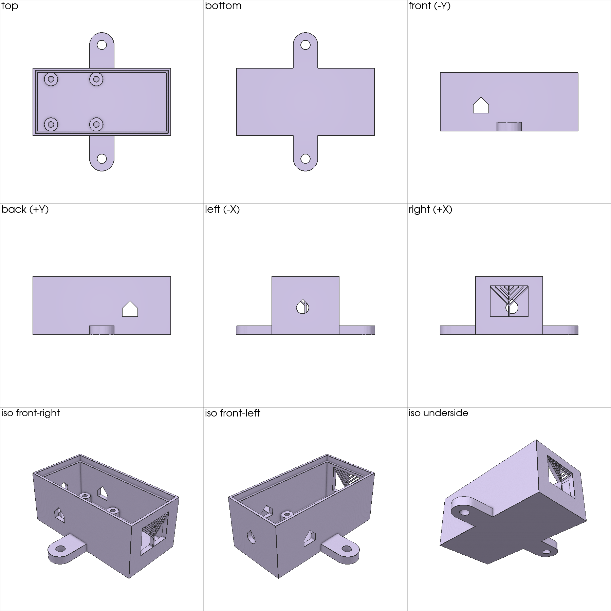

# HALPI2 EndPoint box

Symphony: none yet

Purpose: hold the HALPI2-end QwiicBus EndPoint just outside the HALPI2, where plain I2C becomes cat5e.
A round 4-core lead (a USB offcut will do) leaves the HALPI2 through one of its PG7 glands and enters this box's end wall to a 4-way 2.54 mm screw terminal.
The terminal is soldered at the bench into the board's header row (GND, 3V3, SDA, SCL).
One Qwiic socket feeds the BME688 box, the other is spare; both plugs go in from outside through small holes in the long walls.
The RJ45 goes to the far EndPoint (the IMU tray). The board can be conformal-coated or potted; that choice is still open.



| Part | File | Make |
|---|---|---|
| Box | `out/halpi2-endpoint-box_scad.3mf` | PETG, floor down, slicer supports off; snip the tree out of the RJ45 window |
| Fit gauge, prints first | `out/halpi2-endpoint-box_gauge.3mf` | try an M3 in a post pilot and the clip screws or wood screws in the ears |

61.7 x 30.2 x 26.1 high; 62 across the ears.

## How it mounts

Every mounting screw is outside the cavity; the floor has no holes.

| Where | How |
|---|---|
| DIN rail, behind the breaker panel | preferred clip (Printables 420009), two M3 pan heads through the ears into its inserts, 51 apart. The rail runs along the box's length, so the RJ45 faces along the rail |
| Upside down under a panel | two wood screws (#6 / 3.5) through the same ears |

## Coated or potted

| | Coated | Potted |
|---|---|---|
| Board | four M3 x 8 into the posts, lead into the terminal | same, then resin |
| Qwiic | plug through the side holes | plugs in first; tape round them outside, and over the spare's hole |
| Lead hole | as is | tape or putty round the lead outside |
| RJ45 | its mouth sits in the +x wall's window | tape the window's edge outside; the jack body closes the rest |
| Lid | optional 3 mm plate in the rebate (not drawn yet) | none |

## Numbers and where from

| Value | Source |
|---|---|
| Board 44.45 x 25.4; holes 2.54 / 22.86 from the -x end, 20.32 apart | SparkFun board file, parts.md |
| Qwiic sockets 12.7 from the -x end, one each long edge, mouths 0.48 inside it | same |
| Header row GND 3V3 SDA SCL, 2.54 pitch, 1.27 from the -x end | same |
| Jack overhang 9.7, 16.5 wide | photo, as in lux-tube-cap |
| DIN clip screw pitch 51 | parts.md |

## Guessed

| Value | Now | Check |
|---|---|---|
| Jack height above the board | 13.5 | sets the window height and the rebate |
| Jack bottom flush with the board's top past the edge | yes | if it drops below, the window must go lower |
| M3 pilot | 2.6 | the gauge |
| Ear hole | 4.2 | the gauge; K2 holes print small |
| Qwiic hole 7 x 3.6; a plug through a 2 mm wall still seats | yes | the plug in hand |
| Terminal overhang past the board, wire entry height | 3.5 past, 4 above the board | the terminal in hand |

## Build

```
uv run shop build projects/halpi2-endpoint-box
uv run pytest -q projects/halpi2-endpoint-box
```
