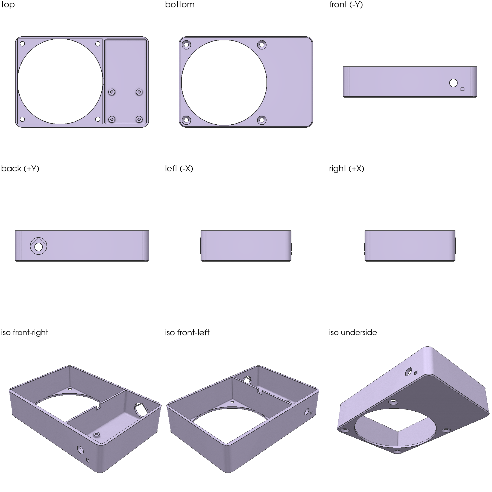
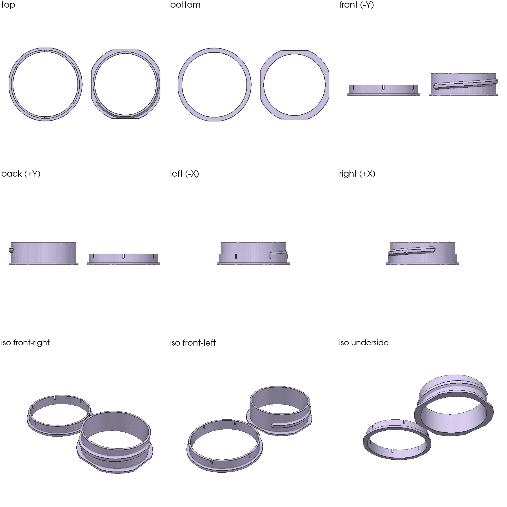

# Heater fan mount

Symphony: [`diagrams/electrical/circuit-inventory.md`](https://github.com/mark-brannan/symphony/tree/main/diagrams/electrical/circuit-inventory.md)

Combustion-air booster for the diesel heater. A 3" flex duct from a deck vent screws onto the bottom,
an 80 mm fan pushes the air up, and a slotted collar is hose-clamped over the heater's bottom rim.
A PWM board in a pocket beside the fan sets the speed from a knob on the cabin face.

## Parts, all PETG

| Part | File | Prints | Volume |
|---|---|---|---|
| Box: fan socket and controller pocket | `part-box.scad` | floor down, open top up, 0.8 mm 45° chamfer round the bed edge; the round knob hole (7.5) bridges its own crown; one-line 45° webs from both sides hold up the gland hole's crown, cut it out after printing; a 3 mm square LED window right of the knob, filled with clear epoxy or CA from inside against tape on the cabin face (its 3 mm top bridges; the fill covers it) | 38.7 cm³ |
| Lid with the 76 mm collar | `part-lid.scad` | plate down | 32.2 cm³ |
| Spigot: flange and duct thread | `part-spigot.scad` | flange down | 18.8 cm³ |
| **Gauge, prints first** | `part-gauge.scad` | ring faces down | 23.5 cm³ |

Every part prints in its model orientation. The knob face prints as a vertical wall, so it shows layer lines, not the plate's texture.
The spigot's 80.4 mm square flange drops into the fan socket and sits on the floor's corners, under the fan; its thread hangs out through the floor, so the box's underside is flat (owner, 2026-11-24). The fan's own four M4 countersunk screws (35 overall, 32.5 threaded, owner) come up through floor, flange, fan and lid: heads flush in the floor, nuts on top of the lid. The countersink's `head_d` is an estimate until the head is measured.
12 V enters through a PG9 gland (16 mm hole) on the back wall, against the bulkhead.

## The gauge

| Ring | Try | If wrong |
|---|---|---|
| Left: 10 mm of the collar, slotted | drop over the heater's bottom rim | change `rim_d` (loose) or `collar_fit` |
| Right: 1.5 turns of the duct rib | screw the duct on | count 10 wire turns over a length; `pitch` = length / 10 |

## Numbers and where they came from

| Number | Value | Source |
|---|---|---|
| Heater rim, outside | ~75.4 (collar bore 76.0) | owner: a 76 bore was near a friction fit on the old part. **Unmeasured**: gauge |
| Duct wire pitch | 15, right-hand | owner estimate, 15-19. **Unmeasured**: gauge |
| Duct ID | 76.2 | 3" nominal |
| Fan | 80 x 80 x 25, holes 71.5 square, bore 76 | GDA8025 IP68 vendor drawing; thickness ~24.5 owner; holes match an earlier test print |
| Controller | 1803BK PWM board, 32 x 32 (35 with break-off edge), holes ~26 square | listing; not calipered |
| Pot shaft above the board | 7 | **estimate** |
| Pot shaft across the board | centred | owner: the knob is centred on the module, so knob, standoffs and pocket share one centre line; pocket 40 wide |
| PG9 gland | thread 15.2, hole 16 | catalogue typical, **unmeasured** |
| Walls | 2 shell, 3 knob face, 1.6 divider, 2.5 lid and flange | set by each wall's job; no structural load beyond the unit's own weight |
