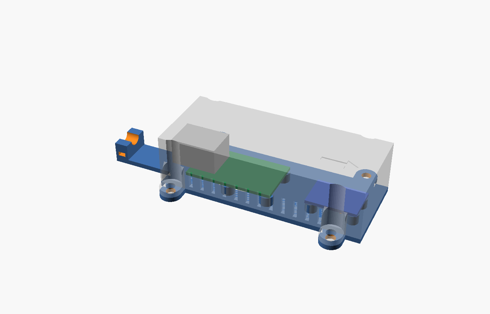

# IMU tray: ICM-20948 and QwiicBus EndPoint, mid-boat

Symphony: [`reference/pypilot_containerization.md`](https://github.com/mark-brannan/symphony/tree/main/reference/pypilot_containerization.md), [`runbooks/pypilot.md`](https://github.com/mark-brannan/symphony/tree/main/runbooks/pypilot.md)

Purpose: hold pypilot's IMU and its cat5e I2C extender on a horizontal shelf in the middle of the boat, in a dry spot.
Not sealed: a vented cover keeps off dust, fingers and dropped tools, and lets the boards breathe so damp doesn't collect inside.
Every joint plugs in (RJ45, Qwiic); no solder.

| Part | File | Print |
|---|---|---|
| Tray | `out/imu-tray_scad.3mf` | floor down, no supports |
| Cover | `out/imu-tray_cover.3mf` | roof down, no supports |
| Fit gauge, prints first | `out/imu-tray_gauge.3mf` | 1 mm outline with 5 mm post rings: check the ear holes and set one insert of each size |

PETG. Outside 134 x 43 (ears 54) x 28.5 high, saddle included.

## What goes in

| | |
|---|---|
| IMU | Adafruit ICM-20948, PID 4554, on four M2.5 brass heat-set inserts; brass or nylon M2.5 screws (steel near the magnetometer is a hard-iron offset) |
| Extender | SparkFun QwiicBus EndPoint 16988, on four M3 heat-set inserts |
| Between them | Qwiic cable, 100 mm: EndPoint's +y port, round to the IMU's -x socket |
| Shelf | four #8 or M4 pan-head wood screws through cover ear and tray ear together |
| Cat5e | one zip tie through the saddle, so a tug pulls on the tray, not the jack |

## Assembly

1. Heat-set the eight inserts.
2. Boards on, screws in. Qwiic cable between them.
3. Tray on the shelf, arrow (+x, the IMU's x axis) toward the bow, or set pypilot's heading offset to match. Plug the cat5e in, tie it to the saddle.
4. Cover over, four screws through both ears into the shelf.

## Coating (optional)

One thin coat of acrylic conformal coating (MG Chemicals 422C or similar) on both boards, Qwiic sockets, RJ45 jack and the IMU chip's top masked or not: acrylic is fine over the ICM-20948. About 15 min of hands-on time.
It guards against salt-air corrosion; the cover does the rest. Skip it if the spot stays dry.

## Numbers and where from

| Value | mm | Source |
|---|---|---|
| EndPoint 44.45 x 25.4, holes 20.32 square from the far end | | SparkFun board file, parts.md |
| ICM-20948 25.4 x 17.78, holes 20.32 x 12.7 | | Adafruit board file, parts.md |
| Jack overhang 9.7, 16.5 wide | | photo, as in lux-tube-cap |

## Guessed

| Value | Now | Check |
|---|---|---|
| Jack height above the board | 13.5 | cover has 2.9 above it |
| Plug axis above the board | 6.5 | plug opening 19 wide, 23 high from the floor |
| M3 insert hole, M2.5 insert hole | 4.0, 3.6 | the gauge |
| Ear hole | 4.8 | the gauge; printed holes run small on the K2 |
| Qwiic plug and cable room on the EndPoint's +y side | 11 | look at the assembly; the cable route isn't modelled |
