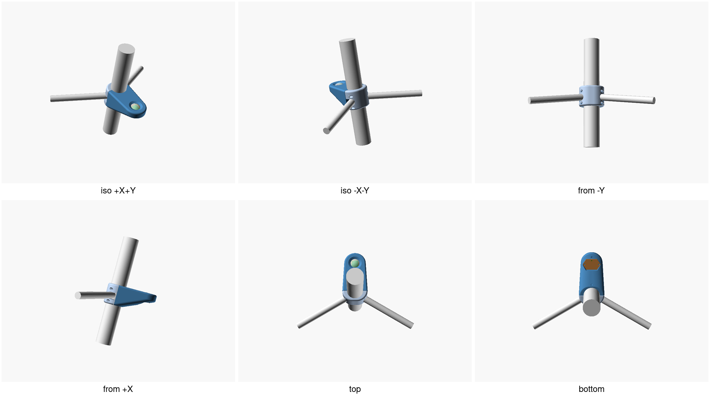

# Lux sensor head on the instrument tube

Symphony: [`diagrams/electrical/symphony-dc-overview.drawio`](https://github.com/mark-brannan/symphony/tree/main/diagrams/electrical/symphony-dc-overview.drawio)

Purpose: an upward-facing VEML7700 lux sensor at the end of an arm clamped to the vane frame's 1.5" tube,
sealed behind a glass cabochon and a PTFE diffuser.

Rev 10, moved here 2026-11-19 from symphony `hardware/lux_sensor/` (symphony#167, #168, #173); this is the only copy.

A two-part collar clamps the tube at its joint with the two 5/8" cross-bars. The bar notches run aft to the split,
so the front half slides onto bars already fixed to the tube. Four M3 x 12 socket heads go in from the forward face
into heat-set inserts in the aft half. A 30 x 20 window in the aft bore meets the cable from the tube's drilled hole
wherever it ends up. The arm is hollow from that window to the dome. Shielded cat5e runs through it, soldered
straight to the VEML7700. The glass and PTFE load from below and are held by the cup, which also carries the board
(potted) and closes the arm's bottom opening. There are drains at the cavity's low point and aft of the cup.

Six-view renders of each model view, from `shop views projects/lux-sensor-mount/model.scad <view>`:
`out/lux-sensor-mount_{assembly,exploded,section,aft_half}_views.png`.

## Parts (one `part-*.scad` each)

| Part | What | Print |
|---|---|---|
| `front` | Front half of the collar; four M3 counterbores, bar notches open aft | split face down |
| `aft` | Aft half of the collar and the hollow arm, glass lip, four clamp inserts, two cup inserts | split face down |
| `cup` | Closes the bottom opening; its rim presses the PTFE onto the glass; holds the VEML7700 in corner blocks; two M3 up through its flange | flange down |

M3 heat-set inserts throughout. PETG.

## Measured, and from what

| Item | Value | Source |
|---|---|---|
| Glass cabochon | 24.8 diameter, 6 high | owner, measured |
| Tube | 1 1/2" (38.1) OD | owner |
| Cross-bars | 5/8" (15.9) | owner |
| VEML7700 (Adafruit 4162) | 16.51 square | its Eagle .brd |

## Guesses (nothing measured yet)

The bars are level and 120 degrees apart in plan, with the V opening forward; the tube is canted 15 degrees aft;
the cat5e is about 6 mm across; the cable hole's position in the tube. A `part-gauge.scad` has not been made.

## Open

- Potting compound and fill level not chosen.
- PTFE sheet not bought; the pocket is square 25.6.
