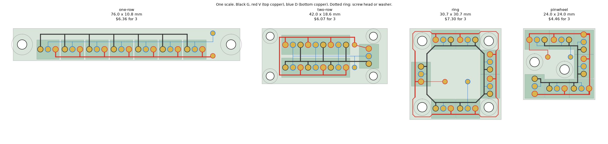

# One-wire bus board

Purpose: tie seven 3-pin screw terminals, each [G D V] in a row, into three nets
(GND, DATA, VCC) with no jumpers and no insulated wire. Six field terminals and a
MASTER whose cable goes to the microcontroller. Any 3-position 2.54 mm screw block, on the front edge, wire entry facing out. Pins are 2.54 mm apart inside a block and 8.2 mm pitch across blocks: the ZPWAN AM128-2.54 body is 8.1 wide by the maker's diagram (7.3-7.8 by calipers), so blocks cannot butt at 3 x 2.54 = 7.62.

Two copper layers, plated pads, no vias: G on top behind the pin row, V on top in front
of it (under the terminal body), D on the bottom between the pin row and G, so D passes under the G stubs.
Hand-built equivalent on a one-sided pad board: bare wire for G and V on the solder
side, one bare wire for D on the top face dipping through each D hole.

R1 is an optional 4.7 k pull-up spot, DATA to VCC, past MASTER: leave it empty when the master has its own.

Outputs in `out/`: `one-wire-bus.kicad_pcb` (KiCad 7 text, generated by `model.py`),
`one-wire-bus.png` (both layers), and `fab/` (below). Board 76.0 x 10.8 mm, two M3 holes 70 mm apart, each
clear of a 7 mm washer. The same pin grid works on a 2.54 mm perfboard.

Ordering, prices and OSH Park's rules: [oshpark.md](oshpark.md).

## Guessed, not measured

| Value | Now | Why |
|---|---|---|
| Pad / drill | 1.9 / 1.3 mm | commodity 2.54 mm screw block (KF2.54-3P class) |
| Body depth, pin setback | 6.5; 3.3 from the front | commodity 2.54 mm screw block; any in-stock 3P part fits |
| Track width, min clearance | DATA 0.5, GND and VCC 1.0 / 0.3 mm | fab-safe defaults; OSH Park's floor is 0.15 |
| R1 pads | 7.62 pitch, 0.8 drill | fits a 1/4 W axial resistor, body up to 6.3 x 2.5 |
| Terminal pin order | G, D, V, left to right with the wire entry facing you | owner's brief |
| Board lip past the body front | 0.5 mm | keeps copper off the edge |

Blocks sit 8.2 mm apart (`block_pitch`): clear of the 8.1 mm diagram width.

## Four forms: which one to order

The same circuit in four shapes. Each is complete: board file, Gerber zip, KiCad rule check clean against OSH Park's limits.
`model.py` builds the one-row board, `layouts.py` the other three.

| | One-row | Two-row | Ring | Pinwheel |
|---|---|---|---|---|
| Board, mm | 76.0 x 10.8 | 42.0 x 18.6 | 30.7 x 30.7 | 24.0 x 24.0 |
| Three boards at OSH Park | $6.36 | $6.07 | $7.30 | $4.46 |
| Terminal blocks | 7 x 3-position | 2 x 9-position, 1 x 3-position | 7 x 3-position | 7 x 3-position |
| Screws | 2 x M3, 7 mm washers | 4 x M2.5, corners | 4 x M3, corners | 2 x M3, 10 mm apart |
| Wires leave | one long edge | both long edges and one end | all four edges | all four edges |
| MASTER | last in the row | centred on the right end | centred on the left side | lower end of the left side |
| G D V printed where it shows once built | yes | yes | yes, inside the ring | bottom face only |
| Upload | [zip](out/fab/one-wire-bus-gerbers.zip) | [zip](out/two-row/fab/one-wire-bus-two-row-gerbers.zip) | [zip](out/ring/fab/one-wire-bus-ring-gerbers.zip) | [zip](out/pinwheel/fab/one-wire-bus-pinwheel-gerbers.zip) |
| Built, with stand-in parts | [front](out/assembled-front.png) | [front](out/two-row/assembled-front.png) | [front](out/ring/assembled-front.png) | [front](out/pinwheel/assembled-front.png) |

Prices are area times OSH Park's $5 per square inch for three boards, not a site quote.

- **One-row**: every cable comes in from one side, as on a DIN rail or along a wall. The longest board.
- **Two-row**: the narrowest board with four screws. It needs 9-position blocks, and their body depth is taken from the
  3-position part, not measured. The M2.5 pan heads beside MASTER clear its body by 0.16 mm: check with the part in hand.
- **Ring**: four M3 screws and a centred MASTER, with room in the middle for the labels and the pull-up. The largest area.
  VCC passes each corner 0.1 mm outside a 5.6 mm pan head, under solder mask: no washer wider than the head.
- **Pinwheel**: the smallest and cheapest. Two screws close together hold it, so the cables want their own strain relief.
  Once the blocks are on, the G D V letters are under them: every terminal reads G D V left to right with its wire entry facing you.

In all three compact forms R1 is the same optional 4.7 k pull-up, and every terminal, MASTER included, reads G D V left
to right from outside. On the ring and the pinwheel the pins inside a block are 2.54 mm apart and the two blocks of a side 8.2 mm apart.
Screw heads: M3 pan 5.6 mm, M2.5 pan 5.0 mm (ISO 7045).
