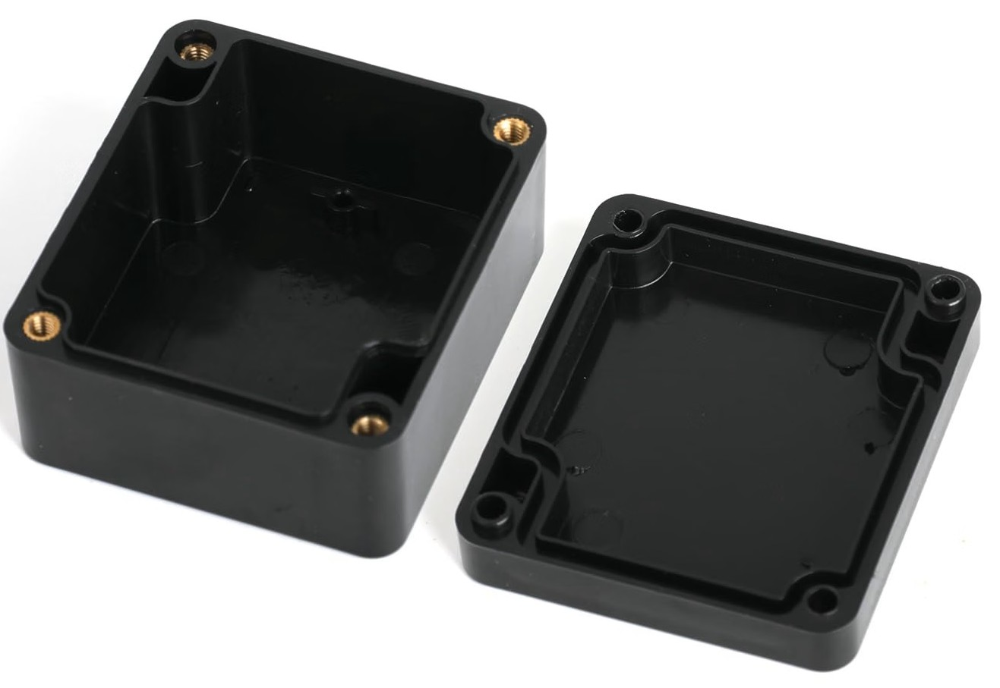
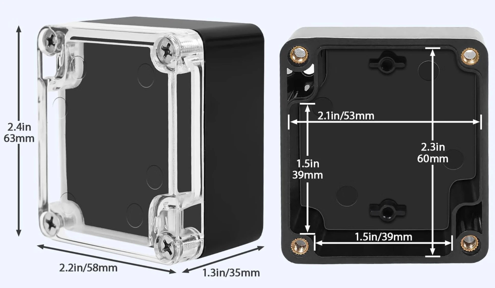

# One-wire enclosure: gland layout

Symphony: [`firmware/halmet/src/halmet_onewire.h`](https://github.com/mark-brannan/symphony/tree/main/firmware/halmet/src/halmet_onewire.h), [`reference/halmet_firmware.md`](https://github.com/mark-brannan/symphony/tree/main/reference/halmet_firmware.md)

**Drilling template:** [`out/drill-template.pdf`](out/drill-template.pdf), 1:1 on A4, one strip per wall (red dotted = where the corner columns start; `uv run python projects/one-wire-enclosure/template.py` regenerates it from `model.py`). Print at 100 %, check the 50 mm bar. Hole positions are still photo-based until the caliper list at the bottom is done.

Purpose: seven cable entries (6 probe glands, 1 master) in the 63 x 58 x 35 ABS box (black or clear lid, same body) with brass-insert corner screws.

The vendor photos the estimates come from: the inside (corner columns, gasket band, lid), the dimensioned outside, and the clear-lid listing with inside dimensions.

  

Vendor: outer 63 x 58 x 35 (an older listing said 64 x 57), 53 inside across the 58 side, 39 mm of straight wall between the corner columns on both walls.
Read off photos, not calipered: lid ~8.5 tall, wall ~2.5, floor ~3, gasket band ~4.5 under the seam, two floor screw bosses (~6 dia, ~4 tall) on the centre line about 5.5 in from each short wall.
Box numbers are shared with `projects/small-box-sensors/box.scad`.
Probe cable: 3.5 OD; probe and heat shrink 6.3 at the widest (owner, caliper, DS18B20 probe on hand). The bare end goes in through the gland; the probe stays outside. That sits mid-range in an M8 gland, so the probes take M8 rather than PG7.
Gland sizes: M8 hole 8.3, nut 11.5-13 across corners (13 used), clamps 2-5 (typical, unchecked); PG7 hole 12.5, nut 17 across corners, ~5 thick; SP13 hole 13, rear body ~13 x ~15 deep, nut unmeasured.

Layout (z from the outer base):

| Wall | Holes | Tightest clearance |
|---|---|---|
| Long A, long B | 2 x M8 at centre +/-10, z 12.5 | 3.0 to columns, floor and gasket band |
| Short A | 2 x M8 at centre +/-10, z 12.5 | 3.0; clears the floor boss |
| Short B | SP13 10 off centre, z 12.5 | 1.0 to the column; body 2.4 clear of the boss |

With M8, a hole may land ~2 mm off and still fit, so a centre punch through a paper template and a step drill will do. PG7 in the same places leaves 0.5-1 mm (bottom row of the picture).
Fails: a centred SP13 (its rear body lands on the floor boss).
Calipers wanted before drilling: boss edge to inside wall face, boss height, M8 nut across corners, SP13 rear depth and its 1 mm to the column.
