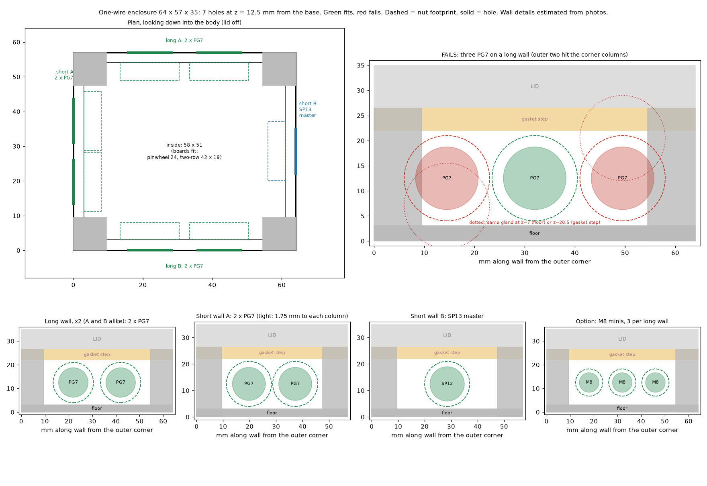

# One-wire enclosure: gland layout

Purpose: seven cable entries (6 probe glands, 1 master) in the 64 x 57 x 35 black ABS box with brass-insert corner screws.

Measured: outer 64 x 57 x 35 (vendor listing). Everything else is read off the vendor photos, not calipered:
lid ~8.5 tall, wall ~3, floor ~3, corner columns ~9.5 from the outer corner, gasket step ~4.5 under the seam.
Gland sizes: PG7 hole 12.5, nut 15 across flats / 17 across corners (varies by maker); SP13 hole 13, nut size not found; M8 hole 8.3, nut guessed 11.5.

Result: all seven fit at z = 12.5 above the base (long walls 2 + 2 PG7, short wall A 2 PG7, short wall B the SP13). Short wall A has 1.75 mm to each corner column.
Three PG7 on one long wall cannot (needs 51 of 45 mm). Height window for a PG7 nut is 3 to 22: only ~1 mm of slack each way.
Calipers wanted before drilling: wall straight length between columns, floor-to-gasket-step height, nut across corners.
