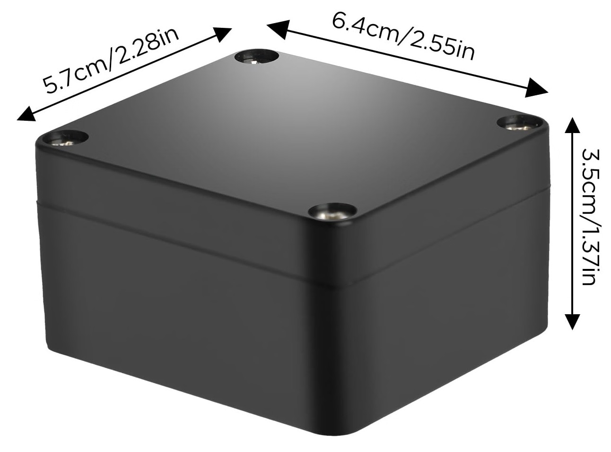

# One-wire enclosure: gland layout

Purpose: seven cable entries (6 probe glands, 1 master) in the 63 x 58 x 35 ABS box (black or clear lid, same body) with brass-insert corner screws.

The vendor photos the estimates come from: the inside (corner columns, gasket band, lid), the dimensioned outside, and the clear-lid listing with inside dimensions.

  

Vendor: outer 63 x 58 x 35 (an older listing said 64 x 57), 53 inside across the 58 side, 39 mm of straight wall between the corner columns on both walls.
Read off photos, not calipered: lid ~8.5 tall, wall ~2.5, floor ~3, gasket band ~4.5 under the seam, two floor screw bosses (~6 dia, ~4 tall) on the centre line about 5.5 in from each short wall.
Box numbers are shared with `projects/small-box-sensors/box.scad`.
Gland sizes: PG7 hole 12.5, nut 15 across flats / 17 across corners, ~5 thick; SP13 hole 13, rear body ~13 x ~15 deep, nut unmeasured.

Layout (z from the outer base):

| Wall | Holes | Tightest clearance |
|---|---|---|
| Long A, long B | 2 x PG7 at centre +/-10, z 12.5 | 1.0 to the corner columns |
| Short A | 2 x PG7 at centre +/-9.5, z 13 | 0.5 to the gasket band; clears the boss in elevation |
| Short B | SP13 10 off centre, z 12.5 | 1.0 to the column; body 2.4 clear of the boss |

Fails: three PG7 on a long wall; a centred SP13 (its rear body lands on the floor boss).
The earlier short-wall spacing (+/-8.75, z 12.5) puts the nut over the boss and misses it only because the nut is thinner than the boss gap.
Calipers wanted before drilling: boss edge to inside wall face, boss height, nut across corners and thickness, SP13 rear depth.
