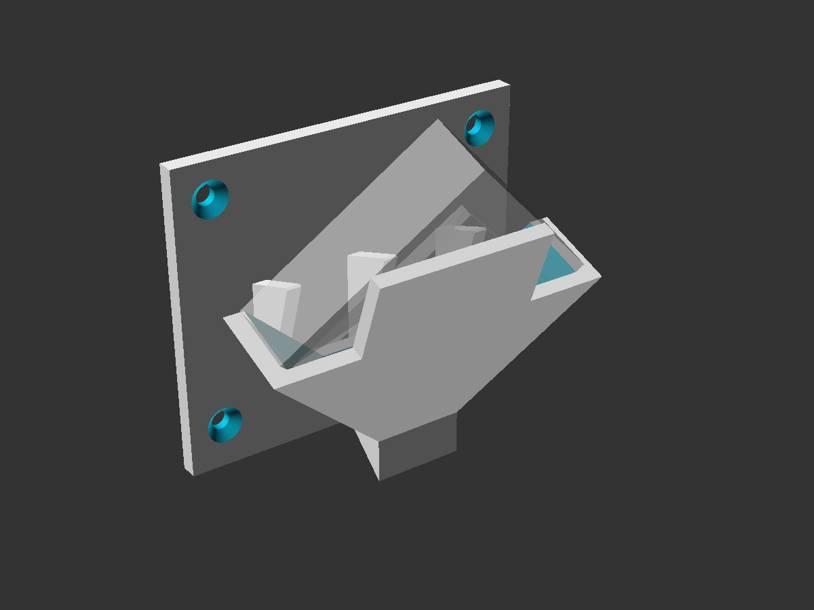

# Onefinity touch-probe holder

Purpose: park the Onefinity touch probe on a vertical surface in front of you (bench or enclosure side), cords still
attached, angled so you can reach in and lift it out. The probe drops in point first, as a diamond, its pocket corner
down. Its two lower edges sit in a 90° V, and its top leans out toward you 20°, so gravity holds it. The large flat
face rests on a support wall on your side; the machined face points up, toward the wall, behind a 15 mm lip. The V
sides reach 42 mm up, about half the probe, and the support wall reaches 65 mm. The top stays open. The cords leave
the two upper edges and nothing gets in their way. Three fins join the cradle's wall side to a 5 mm screw plate.

## Files (out/)

`onefinity-probe-holder_scad.3mf` / `.stl`: the holder, printed as installed: the plate's lower edge and the foot under
the V on the bed. `concept_with_probe.png`, `concept_side.png`: the probe resting in it (preview, `-D show_probe=true`).

Hardware: 4 × #8 (4 mm) countersunk wood screws, about 25 mm long, through a 5 mm plate. Fit the screws with the probe out.

## Measured, and from what

| Value | mm | Source |
|---|---|---|
| Probe block | 63.5 × 63.5 × 18.8 | owner, caliper |
| Pocket | 54 × 54, square to the block, in one corner, open on two edges; leaves 15 thick | owner, caliper; photos |
| Lip | 9.5 wide along the two upper edges (63.5 − 54) | derived |
| Cord exits | roughly centred on the two lipped edges | owner |

## Guessed

| Value | Now | Why |
|---|---|---|
| `tilt` | 20° from vertical, top out toward the user | owner: 15 to 20, top out, bottom near the wall |
| `fit_t`, `fit_v` | 0.6 a side | loose drop-in. It's a holder, not a fixture, so no gauge print |
| `v_depth`, `back_h`, `front_h` | 42, 65, 15 | owner: cover about half the square, a little more on the flat face, top open; cord exits ~67 up stay clear |
| Screws | 4 at ±40, z 12 and 75, below and above the cradle; holes 5, countersink 10 | #8 wood screws, loose; printed holes run small |

## How overhangs are held (print orientation = as installed)

- V arm undersides: 48° from horizontal, because the 45° V is tilted back 20°.
- The support wall's outer face and the lip's inner face lean out at 70°.
- Three vertical fins run from the cradle's wall side to the plate. Their lower ends follow the V line, dropped 6 mm at the plate so they slope steeper than 45°.
- Screw holes run horizontally with teardrop tops. Countersinks are 90° cones.
- The V's lowest 12 mm is hulled straight down into a foot on the bed.
- The test checks there are no faces flatter than 45° facing down.

Volume 74.5 cm³ (about 95 g PETG).
