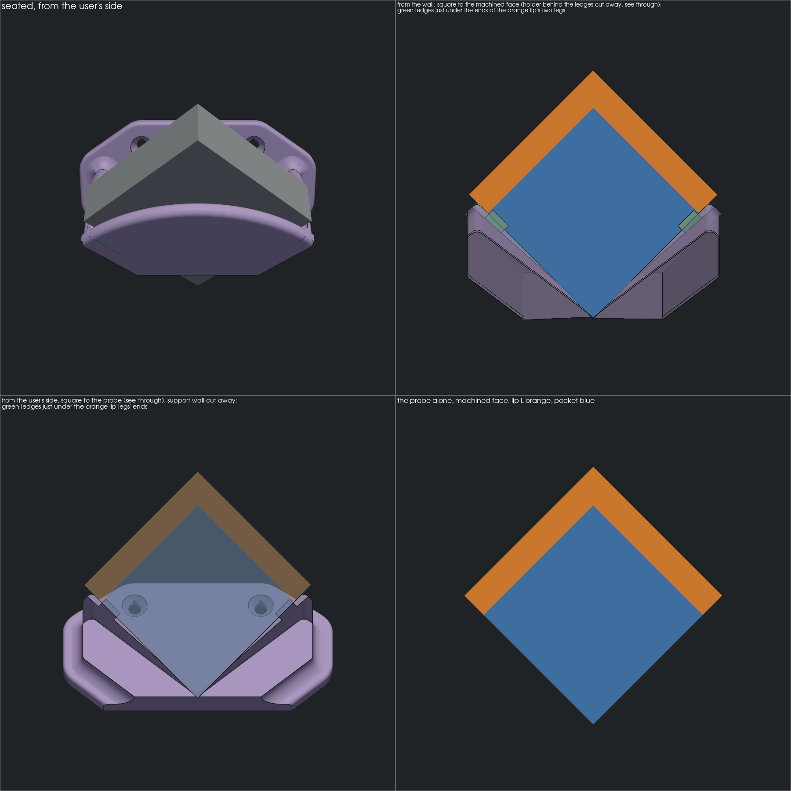
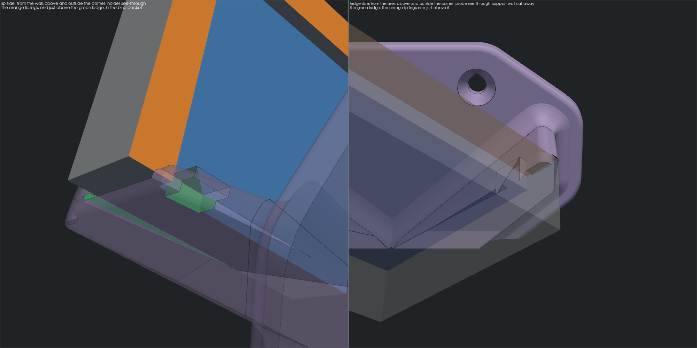
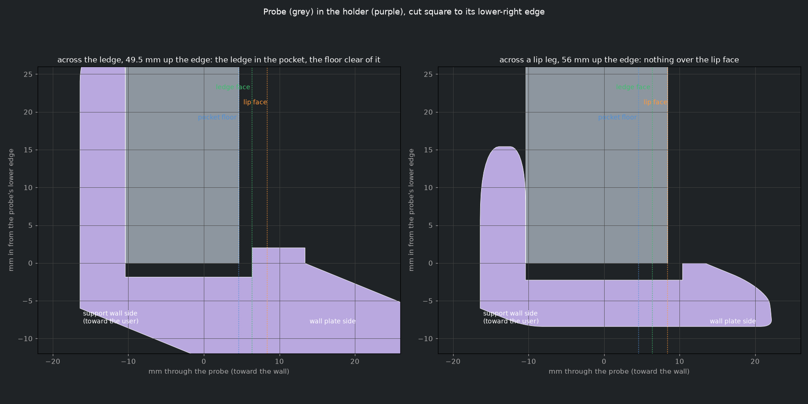

# Onefinity touch-probe holder

Purpose: park the Onefinity touch probe on a vertical surface in front of you (bench or enclosure side), cords still
attached, angled so you can reach in and lift it out. The probe drops in point first, as a diamond, its pocket corner
down. Its two lower edges sit in a 90° V, and its top leans out toward you 30°, so gravity holds it. The large flat
face rests on a support wall on your side, facing down; the machined face (the 54 mm pocket) points up, toward the wall, open between the fins: no lip, since the lean keeps the probe on the support wall and the open side makes a wider target for the point. The V
sides reach 43 mm up, about half the probe, and the support wall, a quarter circle about the V point, reaches 56 mm: past the probe's centre of mass, 46 mm up, and high enough to reach the lip legs' ends. The top stays open. The cords leave
the two upper edges and nothing gets in their way. The V flares out 4 mm a side toward its top so the probe finds its seat by sliding. The V's side walls carry on level toward the wall as fins until they meet the 5 mm plate, so they hold the cradle up; their outsides are flat faces with rounded tops. Fins meet the plate through an R6 concave fillet. The point is open: one horizontal cut, the bed, 12 mm above the tip at the support wall and at the tip on the wall side; the fins and plate end on the same line, so the tip hangs free and only the arms and the support wall hold the probe. Wall-side of the probe, each fin carries one small square ledge in the pocket, just under the end of each lip leg: 8 mm along the edge, 2 mm in over the probe's edge, standing 2 mm past the lip's face so the pocket floor clears it by 1.8; the leg's end sits 0.5 mm above its square top. It is a plain block grown from the fin's inner face, flush with the fin's wall-side face. Nothing covers the lip, so the probe lifts straight out. Outside edges are rounded, the V arms' top edges R2; the support wall's arc rim is rounded on both faces and rolls over the fins' ends, and The fins' outer edges along the V stay square, since their lower side faces down in print.

## Files (out/)

`onefinity-probe-holder_scad.3mf` / `.stl`: the holder, printed as installed: the plate's lower edge on the bed. `assembly.png`, `assembly_lip.png`, `assembly_sections.png`: the probe seated in it, lip legs orange, ledges green, and cuts square to its edge; `assembly.py` redraws them on every `shop build`.

Hardware: 2 × #8 (4 mm) countersunk wood screws, about 25 mm long, through a 5 mm plate. Both sit at the plate's top (z 45), just above the cradle (the fins top out at 39.9), where the probe's weight pulls the plate off the wall; the plate ends 11 mm above them. A drill or driver reaches them straight on, its countersink just clear of the fins.

## Measured, and from what

| Value | mm | Source |
|---|---|---|
| Probe block | 63.5 × 63.5 × 18.8 | owner, caliper |
| Pocket | 54 × 54, square to the block, in one corner, open on two edges; leaves 15 thick | owner, caliper; photos |
| Lip | 9.5 wide along the two upper edges (63.5 − 54) | derived |
| Cord exits | roughly centred on the two lipped edges | owner |

## Guessed

| Value | Now | Why |
|---|---|---|
| `tilt` | 30° from vertical, top out toward the user | owner: 15 to 20, top out, bottom near the wall |
| `fit_t`, `fit_v` | 1.0, 0.8 a side, plus a 4 mm flare at the V's top | loose drop-in that guides itself. It's a holder, not a fixture, so no gauge print |
| `v_depth`, `back_h` | 43, 56 | owner: cover about half the square, a little more on the flat face, top open; the flat face needs cover only past the centre of mass (46 up, the pocket shifts it 1 mm up) |
| `open_v`, `ledge_l`, `ledge_in`, `ledge_h`, `ledge_gap` | 12; 8, 2, 2, 0.5 | owner: about 10 mm of the point open, a flat cut; a small squared edge on the inside just under each lip leg, nothing over the lip |
| Screws | 2 at ±25, z 45, just above the cradle; holes 5, countersink 10 | #8 wood screws, loose; printed holes run small. High, because the load pulls the top of the plate off the wall |

## How overhangs are held (print orientation = as installed)

- V arm undersides: 52° from horizontal. The fins' undersides, run level to the plate, lean 41°: owner accepts.
- The open point's cut is the bed: the cradle, fins and plate all start on it.
- The ledges are plane-faced blocks: top and inner face face up, the lower end leans 52°, the face toward the user 60°.
- The R6 fillet where the fins meet the plate runs from vertical at the plate to the face it joins, so it is never flatter than that face.
- The support wall's outer face leans out at 60°.
- Screw holes run horizontally with teardrop tops. Countersinks are 90° cones.
- The test allows under 40 mm² of flat overhang: the 3 mm corner rounds of the quarter circle pass through flat (44–46°) for a few mm.

Volume 87.0 cm³ (about 109 g PETG), down from 103.3 with the plate cut to end just above the screws (top z 56, was 93).
