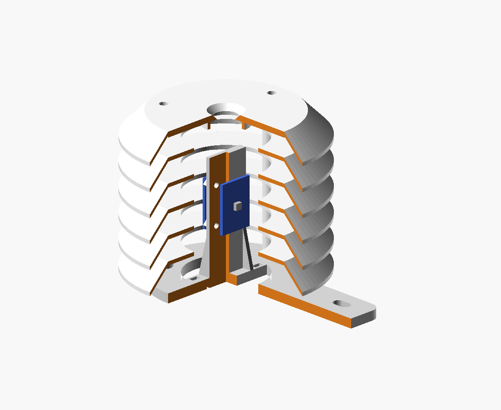

# Outside sensor pod

Symphony: [`firmware`](https://github.com/mark-brannan/symphony/tree/main/firmware)

Purpose: outside air temperature, humidity, light and a second barometer for the boat, published to Signal K.
Only bare, coated sensor boards sit in the weather, inside a louvred shield. A four-wire lead runs to an
ESP32 in the dry, which talks WiFi to Signal K. A drowned pod costs a sensor board, not the node.

Nothing is printed or wired yet. The firmware will live in symphony, beside `firmware/halmet/`.

## Owner's review, 2026-11-18

The shield as drawn does not suit the boat. Do not print it.

- It assumes a flat surface to mount on. The boat has none there.
- It is bulky. The owner wants something small and discreet.
- Places the boat does offer: a vertical hull wall at the stern, or the windvane's bars. On the bars, the lead
  (plain I2C or a cat5e extender) has to run through the metal tube to the lazarette.
- The lux sensor and the pressure sensor may be separated if that helps.
- A photo of the stern is coming from the owner.

Unchanged by the review: the ESP32 sits in the dry, and the wiring and coat tables below still apply.

## What goes in

| Where | Part | State |
|---|---|---|
| Fin, one face | Adafruit LPS35HW, PID 4258 (pressure) | on hand |
| Fin, other face | temperature and humidity board on the same 20.32 hole pair | part not chosen |
| Under the cap's window | lux board | part not chosen; its bosses are not modelled |
| Cap window | 20 mm disc of 3 mm clear acrylic, bedded from inside | to cut |
| Stack | 3 x M4 stainless rod, ~95 long; dome nut and washer on top, nyloc under the base | to buy |
| Boards to fin | 2 x M2.5 x 16, nuts | to buy |

The barometer does not need to be outside: cabin and outside pressure are the same, and wind on an exposed
port adds error (0.4 hPa at 15 kn, 1.5 hPa at 30 kn, from ½ρv²). It rides along because its sensing element
tolerates wet; the louvres also baffle the wind.

## Printed parts

| File | Part | Count | Prints |
|---|---|---|---|
| `model.scad` | louvre | 5 | upside down: in-use top face on the bed |
| `part-cap.scad` | cap with the window seat | 1 | upside down |
| `part-base.scad` | base: ring, fin, mounting tongue | 1 | as used |

White ASA, no supports. Each skirt is 45° and laps the plate below by 1 mm, so there is no level line of sight
into the cavity; the air channel between skirts is 7.8 mm. Stack height 86, diameter 100.
The pod is open underneath and is not sealed anywhere: water that gets in runs out.

## Wiring

| Lead | Pod end | Dry end |
|---|---|---|
| V+ | VIN pad | ESP32 3V3, so the bus idles at 3.3 V |
| GND | GND pad | GND |
| SDA | SDI pad | SDA, through the LTC4311 |
| SCL | SCK pad | SCL, through the LTC4311 |

Solder the lead to the header pads; board to board, short soldered jumpers. The STEMMA QT sockets stay empty
outdoors. The lead leaves through the open base, zip-tied to the bridge slots, with a drip loop below the pod.
Plain I2C at 100 kHz suits a lead under about 2 m (400 pF bus limit, cat5e near 52 pF/m: specs, not measured).
LPS35HW address 0x5D (board silkscreen); the jumper on the back changes it.

Dry side, not designed yet: 12 V, fuse, transient suppressor, 5 V buck, ESP32, LTC4311. Prototype on the
ESP32 breakout on hand ([esp32-breakout-mount](../esp32-breakout-mount/)); a carrier board follows once the pinout has
survived on the boat.

## Conformal coat

Adafruit: the sensor is water resistant, the breakout is not.

| Zone | Do |
|---|---|
| Sensor can, centre of the board | Mask. Never coat the port (our reasoning; ST's datasheet not read) |
| Humidity sensor's opening, lux sensor's face | Mask |
| STEMMA QT sockets | Unused; flood with coat |
| Regulator, level shifter, resistors, capacitors, LED, lead joints, back-side jumper, board edges | Coat, both faces |

Acrylic coat, not silicone: [enclosure-materials](../gas-sensors/enclosure-materials.md) records Sensirion
forbidding silicone coatings beside its gas sensors, and a gas sensor may share a pod one day.

## Guessed, not measured

| Value | Now | Check with |
|---|---|---|
| M4 rod clearance | 4.5 | calibration project's hole number, or a test print |
| M2.5 clearance | 2.9 | same as small-box-sensors |
| Board height off the fin | 3 | the board in hand: back-side jumper and lead joints |
| Acrylic disc seat | 20.4 x 3.5 | the cut disc |
| Mounting tongue | two M5 slots, 20 apart | placeholder until the site is chosen |
| Skirt at 45° in ASA | unprinted | first louvre off the printer |

## Open

- Mount site. Candidates named so far: the 1.5 in tube of the windvane frame (clear of the vane's swing), the 1 in
  stern pulpit tube, or a box on the hull near the gunwale with a gland into the lazarette. A clamp follows the
  caliper reading and which way the tube runs.
- The lead's way into the lazarette: beside the AIS and stern light glands, or a new one.
- Temperature/humidity and lux parts.
- Whether the lazarette ESP32 shares a box, a supply or anything else with a pypilot rudder sensor and motor
  controller.

## Measured, and from what

LPS35HW board: Adafruit's `Adafruit LPS3X.brd` (the STEMMA QT revision): 25.4 x 17.78, two 2.5 holes 20.32 apart
and 2.54 in from one long edge, sensor at the board's centre. Row in [`parts.md`](../../parts.md). Nothing calipered.
