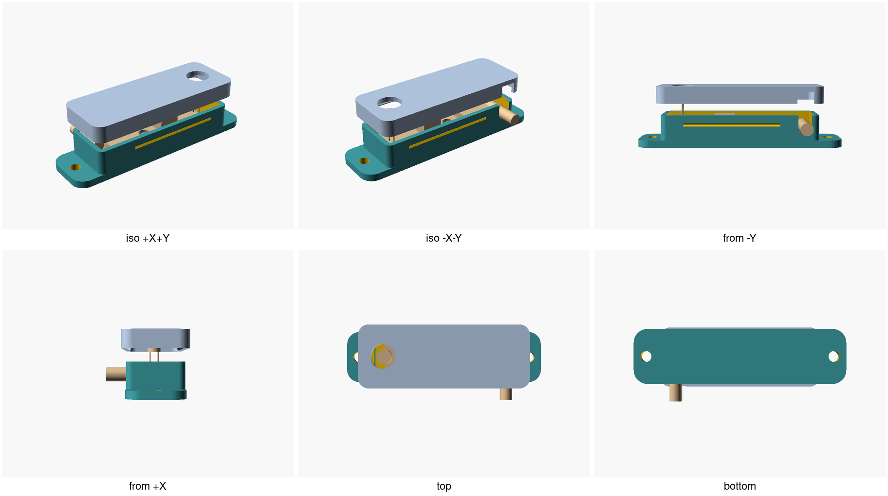

# Photocell flame pod

Symphony: [`reference/halmet_firmware.md`](https://github.com/mark-brannan/symphony/tree/main/reference/halmet_firmware.md)

Purpose: a small potted pod for one LM393 photoresistor module ([`parts.md`](../../parts.md)), several
placed around the engine room as flame detectors.

- **Tray** (`model.scad`), PETG (oil resistance; UV is no concern in the engine room), printed floor down.
  The module sits component side up on two edge ledges; a pin on a boss through its hole locates it.
  Epoxy fills to the photocell body's underside: board, trimpot, leads and cable entry sealed, cell face proud.
- **Cable** leaves through the side wall near the header-end corner, clear of both mounting tabs; the epoxy holds it.
- **Gauge** (`part-gauge.scad`, generated by `shop gauge`): the floor and a 2 mm ring of wall at board height.
  Prints first: the board should drop in over the pin.
- **Lidded build**: `potted = false` gives a taller tray, an M3 into a pressed nut, and corner columns
  for the 3 mm clear acrylic lid in `part-lid.scad`.

Outside 52.7 x 21.3 x 15.1, the cell 2 mm above the rim; 68.7 long over the tabs. Tray about 5.5 cm³
(7 g PETG); about 8 ml of epoxy per pod (calculated from the model, not poured).

## Potting

1. Set the trimpot first: it is buried for good after the pour.
2. Solder the cable to the pins, heatshrink, drop the board over the pin and the cable into the side exit.
3. Seal round the cable in the exit from outside (tape or putty), then pour to 0.5 below the rim.

## Wiring

Three wires, G D V, star-wired to their own copy of the
[one-wire bus board](../one-wire-bus-board/): every pod's signal on the one D net, so any pod that sees
light pulls it low (wired-AND of the open-collector outputs). Not the board the DS18B20 probes are on:
they would share the data net. Leave R1 empty: each module carries its own pull-up.
Read the pin order off the module's silkscreen; the bus board is G, D, V.

## Measured, and from what

| Value | mm | Source |
|---|---|---|
| Board | 31 x 14 | owner, caliper |
| M3 hole | ~4, centred across, rim 5 from the header end | owner, caliper |
| Trimpot top | 4.6 above the board top | owner (halmet-enclosure-mount) |
| Photocell top, bent up | ~11.5 above the board top | owner |

## Guessed

| Value | Now | Why |
|---|---|---|
| `board_t` | 1.6 | standard PCB |
| `cell_t` | 2.5 | cell body thickness; the epoxy line is its underside |
| `solder_out` | 9 | board edge to the end of the heatshrink over the pins |
| `cable_d` | 4.5 | exit for a 3-core cable; caliper the cable |
| `pin_z` | 1.27 | right-angle header pin row above the board top |
| `fit`, `locate_d` | 0.3, 3.4 | PETG fits uncalibrated |
