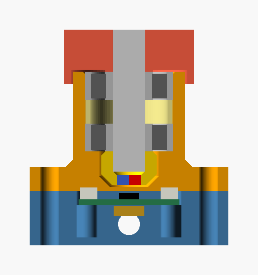

# Rudder angle sensor

Symphony: none yet

Autopilot work is symphony#171; no symphony path covers the lazarette yet.

Purpose: a home-made stand-in for [pypilot's rudder sensor](https://pypilot.org/opencart/index.php?route=product/product&language=en-gb&product_id=54):
a Hall chip reads a magnet on the end of a shaft, with no contact and no seal, and gives a 3-wire analog angle. It bolts to the seat of
[`rudder-sensor-pedestal`](../rudder-sensor-pedestal/); its arm takes an M3 ball link and a 3 mm rod to the quadrant.

Rev 2, not printed. Nothing here is measured.

The magnet (red and blue) turns in a chamber closed underneath by a 1 mm wall; the chip (black) is under that wall, in a cup potted to
the rim. Magnet face to chip top is **1.9 mm**: 0.5 air, 1.0 wall, 0.4 to the chip. Other views: `out/rudder-angle-sensor_{assembly,exploded}_views.png`.

Assembled it is 50 × 34 on the seat and 54 tall (14 of cup, 30 of body, 10 of hub), with the arm reaching 106 from the shaft.

## The board's output is 0 to 3.3 V, not 0 to 5 V

Read from Adafruit's schematic for the 6357: the chip's `VDD5` and `VDD3` pins are both on net `3.3V`, the output of the AP2127K-3.3
regulator `U2`, whose input is net `VCC` (header pin 1, VIN). The chip's output pin is net `PWMOUT`, header pin 6. So fed 5 V, this
board's output swings 0 to 3.3 V and follows the regulator, not the 5 V supply. pypilot's own sensor is ratiometric to 5 V.

2026-11-20: this board stays, at 3.3 V full scale; pypilot's rudder calibration takes up the scale. The other way, not taken, is an
AS5600 board wired the datasheet's 5 V way (5 V on VDD5V, only a capacitor on VDD3V3); ams's AS5600-SO_EK_AB ships like that.

From the AS5600 datasheet, not checked on a part: the analog output spans a full turn by default, so ±35° of rudder uses about a fifth
of the swing until the range is narrowed over I2C, and the wrap point has to sit outside the rudder's travel.

## Sizes

| Size | Value | Source |
|---|---|---|
| Board outline, corner radius | 25.4 × 17.78, r 2.54 | [Adafruit's Eagle `.brd`](https://github.com/adafruit/Adafruit-AS5600-Magnetic-Angle-Sensor-PCB), layer 20 |
| Board mounting holes | four, 2.5 drill, 20.32 × 12.7 | same file |
| Chip position | board centre (12.7, 8.89), on the top side | same file, part `X1` |
| JST SH sockets | top side, 10.12 either side of the chip, 4.25 × 6.1 | same file, parts `CONN3`, `CONN4` |
| Header | six holes at 2.54 along one long edge, 6.35 from the chip | same file, part `JP1` |
| Board thickness | 1.6 | guess |
| Chip height | 1.6 | guess |
| JST SH socket height | 2.95 | guess |
| Bearing | 608: 8 × 22 × 7 | owner's stated on-hand size, not caliper-measured |
| Bearing inner ring outer diameter, outer ring inner diameter | 12, 19 | guess |
| Shaft | 8 | guess; the 608's bore |
| Magnet | 6 × 2.5, diametric | guess |
| Flange | two M4 at 40, socket heads 7 across | guess, the pedestal's own guess |
| Arm centre | square to the line of the two flange screws | so both stay reachable through ±40° |
| Arm stud radii | 60, 80, 100 | guess; 100 is the pedestal's `arm_len`. The one used must equal the quadrant stud's radius |
| Every fit clearance | see `/* [Fits] */` in `model.scad` | guess; the repo's calibration table is unmeasured |
| Room under the board for header and plug | 8 | guess |
| Cable | 5 | guess |

Every bought part is a parameter at the top of `model.scad`, and the model stops with a message where a combination can't work.
The tests also build the owner's other on-hand bearing, R8 (1/2 × 1-1/8 × 5/16 in) on a 12.7 mm shaft, a 686 on a 6 mm shaft, and a
bare 23 mm module. The R8's tower covers M4 heads at 40, so that set moves the flange holes to 48 and the pedestal's seat would follow.

## Parts and how each prints

All five print flat with no slicer supports; `out/rudder-angle-sensor_scad.3mf` is the plate, one 3MF per part beside it.

| Part | Prints | Overhangs |
|---|---|---|
| Bearing body | floor down | The chamber is a 45° funnel from a narrow well at the floor, and it and the bearing bore only widen upward. The two JST reliefs in the underside have gable roofs. The cone sockets are 45°. The weep hole is a teardrop. |
| Electronics cup | open top up | Cable exit is a teardrop. Posts, pins and cone studs grow from the floor and rim. |
| Magnet cap | bearing side down | 45° chamfer on the bed side, so it touches the inner race only. It narrows upward at 45° to a nose round the magnet. Magnet pocket opens upward. |
| Arm | top face down | Hub, skirt and the step onto the inner race grow upward. Pinch screw hole and head pocket are teardrops, the nut trap a point-up hexagon. |
| Spacer sleeve | on end | none |

## Changed from the concept

- The JST sockets on the 6357 are taller than the chip, so a flat floor would put the magnet 3.2 mm from the chip. The body has two
  reliefs in its underside for them; the chip comes up to 0.4 under the wall.
- Rev 2: the bearing is wider than the gap between the two reliefs. The cap narrows to a nose round the magnet and the chamber is a
  funnel, so both pass between the reliefs, 1.8 mm of plastic from their roofs, and the bearing sits above them. No limit on bearing size is left.
- Rev 2: the arm is narrow from the hub and centred square to the flange screws; rev 1's covered one.
- Body and cup are located by two cone studs on the cup's rim in cone sockets in the body, because the body's underside is its print
  bed and can't carry a spigot.
- The flange is the pedestal's M4, not M3.
- The arm's hub is as wide as its skirt and prints upside down, so nothing overhangs; the pinch slit runs through the skirt.

Suggestions the owner hasn't asked for, both in the model: the **skirt** on the arm's hub, lapping 3 mm down the body's top to shed
spray (`skirt_lap`), and the **weep hole** from the magnet chamber out the body's side (`weep_d = 0` removes it).

## Not printed

- AS5600 breakout (Adafruit 6357 by default; see the 3.3 V note)
- 6 × 2.5 diametric disc magnet
- 8 mm stainless shaft, about 36 long (`shaft_len` is echoed by the build); non-magnetic, 304 or 316
- two 608 bearings. Skate-type 608s are usually carbon steel: are the ones on hand stainless, or sealed?
- M3 × 16 screw and nut for the pinch clamp
- two M4 × 30 socket head screws for the flange, through body and cup into the pedestal; a washer does not fit beside the tower
- two M3 ball links, a 3 mm rod, and an M3 nut for the stud on the arm
- 3-conductor cable, a crimped 3-way plug, and a right-angle pin header soldered to the board's underside, pins running back under
  the board. No flexible wire is soldered to the board.
- potting epoxy, and putty to close the cable exit while it cures

## Assembly

1. Glue the magnet in the cap's pocket, face flush. Press and glue the cap on the shaft's end.
2. Drop shaft and cap into the body. Lower bearing, sleeve, upper bearing over the shaft; a drop of retaining compound on the outer races.
3. Arm on the shaft, pressed down lightly to take up bearing play, then the pinch screw.
4. Solder the header to the board, trim its stubs on the chip side, plug the cable in, seat the board on the cup's pins, cable out the side.
5. **Bench test before potting:** body on the cup, 5 V on, turn the arm, read the output across the whole travel.
6. Close the cable exit with putty, fill the cup to the rim, cure.
7. Body on the cup's studs, both onto the pedestal with the two M4.

## To fill in before printing

- The 608's inner ring outer diameter and outer ring inner diameter, by caliper
- Board actually bought, if not the Adafruit 6357
- Magnet diameter and thickness; shaft diameter and whether a magnet sticks to it
- Quadrant stud radius, which fixes the arm hole
- Header and plug: the height they need under the board
- Fit clearances, once `projects/calibration/` has numbers

Open: axis offset. The datasheet wants the magnet within 0.25 mm of the chip's centre; here that rides on printed pins, studs and a
printed bore, none of it measured. The bench test is the check.
