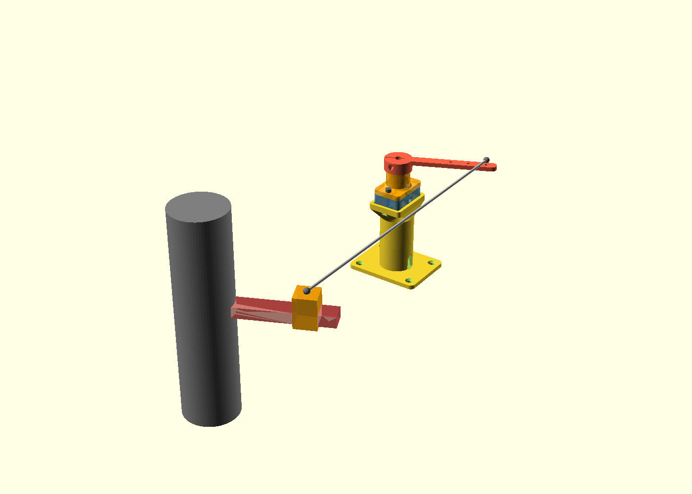

# Rudder sensor pedestal

Symphony: none yet

Autopilot work is symphony#171; no symphony path covers the lazarette yet.

Purpose: hold the home-made [`rudder-angle-sensor`](../rudder-angle-sensor/) (rev 2) low in the lazarette on starboard, the ram's
side, at the cable quadrant's height, so a 3 mm rod to a stud on the quadrant makes a parallelogram and the sensor reads the rudder 1:1.

Prototype, not printed. Nothing here is measured.

`view="assembly"` draws the sensor's own body, cup and arm on the seat, the rod and the quadrant's clamp block (none printed here),
rudder at 25°. The sensor's arm centres on +X (aft), so its two flange screws lie across that, along Y.

## Sizes

The seat is not typed here: `model.scad` reads the sensor's footprint, holes, heights and turn from
[`../rudder-angle-sensor/model.scad`](../rudder-angle-sensor/model.scad), and follows it when those change.

| Size | Value | Source |
|---|---|---|
| Sensor footprint on the seat | 50 × 34.1, the 50 along the two screws | the sensor's model; guess there |
| Flange screws | two M4 at 40, holes 4.8, square to the arm's centre | the sensor's model; guess there |
| Sensor height, cup floor to arm top | 54.2 (13.6 of cup, 40.6 above the flange face) | the sensor's model; guess there |
| Arm stud radius | 100, of the sensor's 60, 80, 100 | guess; must equal the quadrant stud's radius |
| Seat lip over the sensor's foot | 0.6 on the width, 2 high | guess; the repo's calibration table is unmeasured |
| M4 hex nut | 7.0 across flats, 3.2 thick | guess: ISO 4032 nominal, not the nuts on hand |
| Nut slot over the nut | 0.4 on width and height | guess |
| Plastic over each nut | 5 | guess |
| Column height (mount surface to seat) | 80 | guess; set by the quadrant's height above what the base screws to |
| Rod length (stock to sensor shaft) | 300 to 420 | guess, from the photo's ratios and the drive's pin distance |
| Base screws | four #10 wood screws | guess; assumes wood or a floor to screw to |

The seat no longer matches pypilot's own sensor as first guessed here (50 × 35 × 22, two M4 at 40 along the arm's line; the owner
says it has three holes).

## How the sensor is held

Two M4 × 30 socket head screws go down through the sensor's flange and cup into the plate, and each meets a hex nut in a slot
just under the plate. The slots open at the plate's two ends, on the Y axis (toward the stock and away from it): slide a nut in, a point
leading, until it stops under the hole. The screw takes the whole nut with 2 mm to spare; anything over 32 long bottoms out.

## How it prints

Base down, as modelled, no slicer supports.

| Feature | Held by |
|---|---|
| Plate over the column | a flare at 45° out to the plate's corners (shallower before this change), steeper on its flat sides |
| Column bore's top | closes to a point at 45° |
| Lead exit at the foot | pointed top |
| **Nut slot ceilings** | **a flat bridge, 7.4 from wall to wall, about 13 long: not held by shape.** The nut needs a flat face to pull against and that face looks down. The screw hole above it starts over two bridge layers laid at 90°, so no strand ends in mid-air. `shop build` warns on both slots |

## Open

- The two nut slot bridges: is 7.4 mm of plain bridge acceptable, or should heat-set inserts take the screws instead?
- What the base fastens to on starboard at quadrant height.
- The clamp block on the quadrant spoke (not modelled).
- The sensor's cable leaves its cup at the side, under the arm. The hole down the column and the exit at its foot were for
  a lead out of the bottom of the first-guessed sensor, and this one doesn't use them.
- No fit gauge for the seat yet; the sensor isn't printed either.
