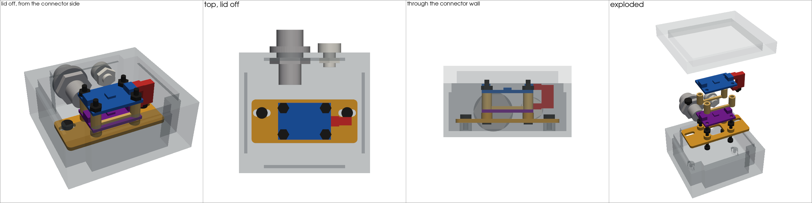
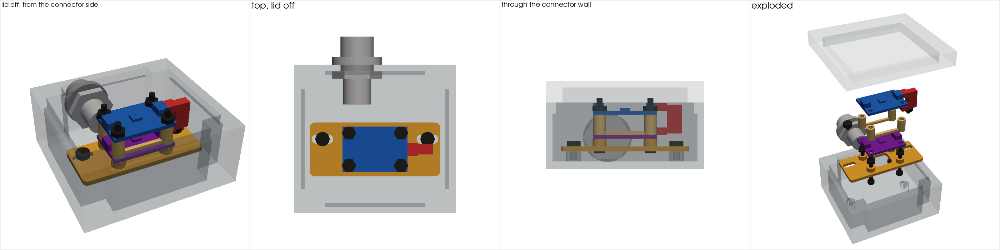
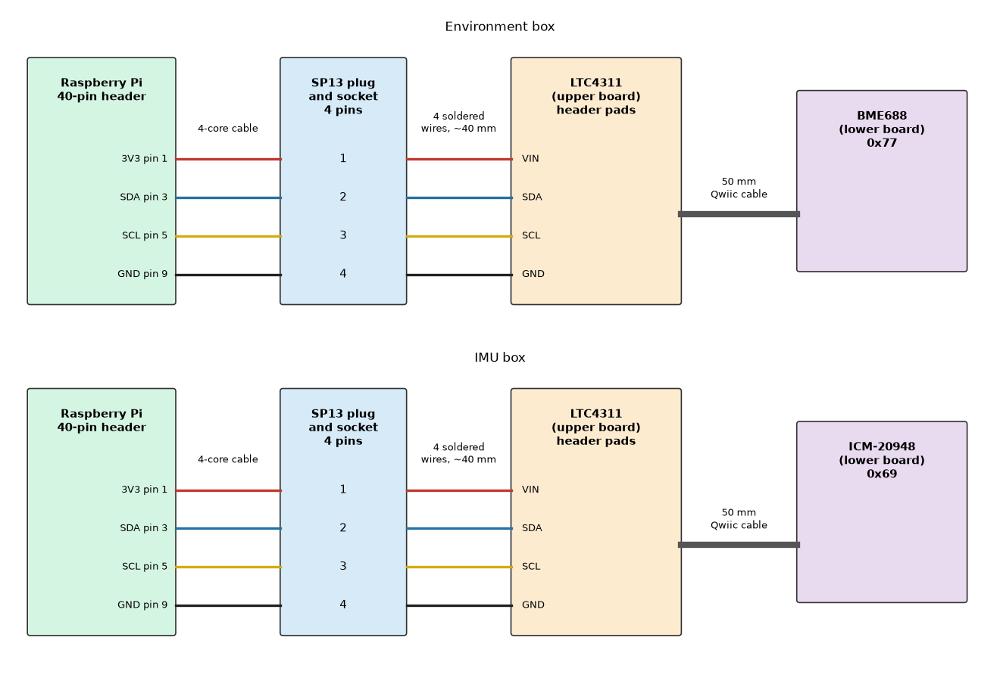
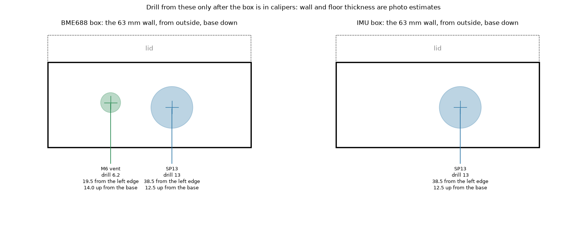

# Small-box sensors: BME688 and ICM-20948 in the 63 x 58 x 35 box

Purpose: two sensor nodes on a Raspberry Pi's I2C (Signal K, pypilot), each in the small ABS box:
an environment box (BME688, breather vent) and an IMU box (ICM-20948). Each carries an LTC4311
I2C extender and one SP13 4-pin socket. One printed carrier and one spacer serve both.

## What goes in

| | Environment box | IMU box |
|---|---|---|
| Lower board | Adafruit BME688, PID 5046 | Adafruit ICM-20948, PID 4554 |
| Upper board | Adafruit LTC4311 extender, PID 4756 | the same |
| Between the boards | 50 mm Qwiic cable | the same |
| Wall, 63 mm side | SP13 4-pin socket, M6 x 0.75 membrane vent | SP13 4-pin socket |
| Printed | carrier, spacer | the same |
| Screws | 4 x M2.5 x 20 and nuts, 2 x M3 self-tappers for the floor bosses | the same, the M2.5 in nylon or brass |

The three Adafruit boards share one outline (25.4 x 17.78) and one hole pattern (20.32 x 12.7, M2.5),
which is why one carrier does both. No custom PCB: the LTC4311 needs four wires and nothing else.
The SparkFun QwiicBus EndPoint (differential, PCA9615) is 44.45 long with an RJ45 jack and does not fit.
If a run proves too long for the LTC4311, a PCA9615 board drawn to the same 25.4 x 17.78 outline drops into the upper bay.

## Wiring

SP13 pin numbers are our convention, not the maker's: keep them the same at both ends. The four wires
solder to the LTC4311's header pads, whose edge faces the connector wall.

## Drilling

Both holes sit on the plain wall between the corner columns, under the gasket band, flats of the SP13 nut
toward the floor. A PG7 gland (hole 12.5) can take the SP13's place at the same centre.

## Assembly order

1. Four M2.5 x 20 up through the carrier from below, heads in their pockets.
2. Lower board, spacer (bars down, open ends toward the plugs), upper board, nuts.
3. Qwiic cable between the two boards at one end.
4. Carrier onto the two floor bosses, two M3 self-tappers through the slots.
5. SP13 socket and vent through the wall, nuts inside; solder the four wires.

## Clearances (model, all on estimated box numbers)

| Between | mm |
|---|---|
| Stack screw tips and the lid's underside | 4.3 |
| SP13 rear and the boards' edge | 8.6 |
| SP13 nut and the gasket band above / the floor below | 1.0 / 1.0 |
| SP13 nut and the corner column | 2.7 |
| SP13 nut and vent nut | 3.4 |
| Vent nut and the corner column | 1.7 |
| Qwiic bend and the short wall | 6.3 |
| Carrier ends and the short walls | 3.5 |

`assembly.py` intersects every pair of components and the test fails on any overlap: 0 mm3 in both builds.

## Measured, and from what

The box: outer 63 x 58 x 35, 53 inside across, 39 clear between corner columns on both walls
(vendor listing, [clear-lid photo](out/ref-clear-lid.webp)). The listing's 60 inside length disagrees with its own
63 outer and is not used. Nothing is calipered.

| Guess | Now | Check with |
|---|---|---|
| Floor boss pitch | 41 (39 to 42.5 by pixel scale); slots cover 36 to 46 | the gauge |
| Boss height, hole | 4, 2.5 (M3 self-tapper) | calipers; the gauge's slots show the screw size |
| Wall, floor, lid plate | 2.5, 3, 2.5 | calipers |
| Gasket band | 4.5 tall, 1.5 proud | calipers |
| SP13 nut, depth inside | 17 across flats, 13 behind the wall | the part in hand; only cut-out 13, flange 19.5 and overall 19.2 are from the Weipu drawing |
| Vent nut | 10 across flats x 2.5 | the part in hand (Gore XS M6 drawing gives hole 6.2, head 11.2, thread 7) |
| Board thickness, part height | 1.6, 3.0 | calipers |
| BME688 outline and holes | as the BME680 board file | the board in hand |

Print `out/small-box-sensors_gauge.3mf` first: a 1 mm slice of the carrier. It proves the boss pitch,
the screw size and the board holes before the carrier prints.

## Not confirmed

- The Signal K plugin `@oehoe83/signalk-raspberry-pi-bme680` does not state BME688 support.
- BME690: only Pimoroni sells a breakout (about 19 x 19, hole positions not found); it does not fit this bay, and its driver is separate from the BME680's.
- pypilot's RTIMULib2 finds the ICM-20948 at 0x68 then 0x69 (source read); not run here.
- The BME688's gas reading through one 6 mm membrane will lag the air outside. No number for by how much.
- IMU box: the SP13's shell and the lid screws sit within 30 mm of the magnetometer; pypilot's compass calibration is what absorbs that.

Sources for every part number are in [`parts.md`](../../parts.md).
